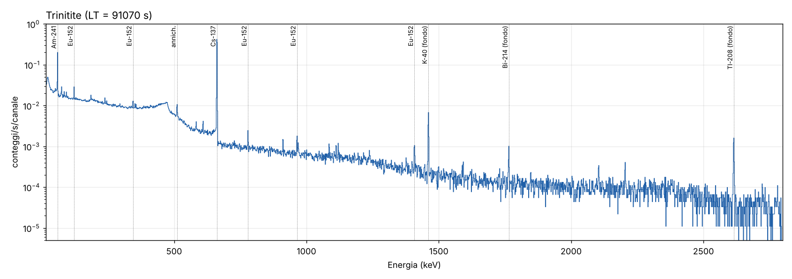
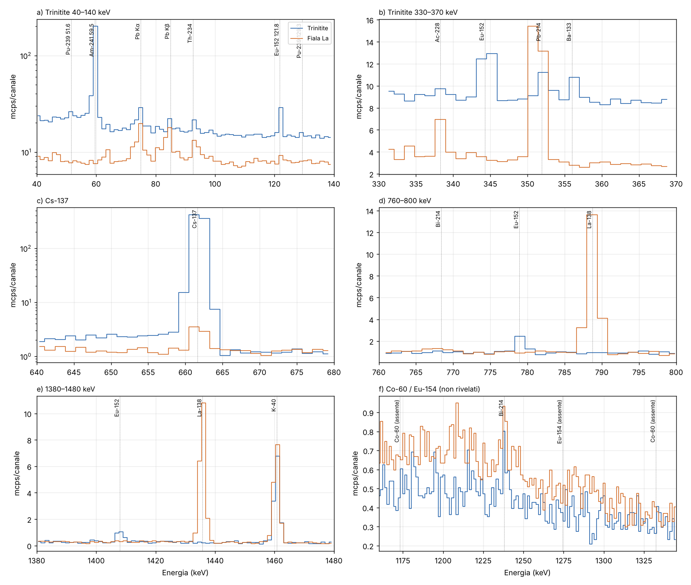
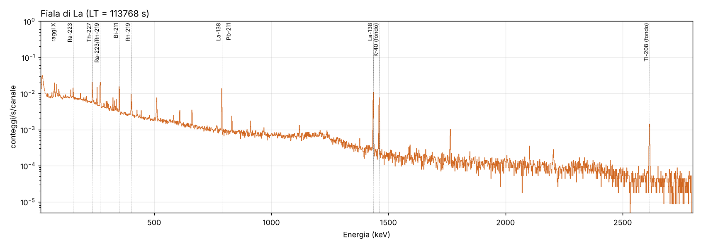
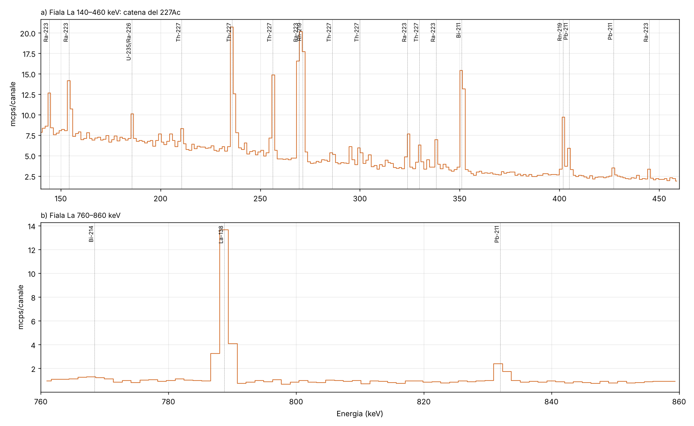

# Analisi di spettri γ HPGe: trinitite e fiala di lantanio

I due campioni sono stati misurati in momenti diversi e sono **analizzati in modo indipendente**. Ciascuno spettro è valutato solo con informazioni interne a sé stesso, senza confronti né sottrazioni incrociate.

**Strumentazione comune** (dai file): GammaVision 6.08, MCA Easy-MCA-2k SN 15043603, 2048 canali, ~1,385 keV/canale, intervallo 0–2840 keV.

Per nessuna delle due misure sono disponibili una calibrazione in efficienza, uno spettro di fondo, la massa del campione o la geometria di misura. Di conseguenza **non riporto attività assolute (Bq)**. Riporto invece:
- i nuclidi identificati con i tassi netti di conteggio;
- i rapporti di attività ottenuti con una *calibrazione in efficienza relativa interna* al campione;
- i limiti di rivelabilità per i nuclidi attesi ma non osservati.

## 0. Metodo (comune alle due analisi)

1. **Calibrazione in energia.** I file contengono la calibrazione di GammaVision (E = −0,050 + 1,38516·ch + 7,3·10⁻⁷·ch²). L'ho verificata e rifittata con picchi di riferimento noti, ottenendo E = 0,193 + 1,38546·ch + 5,34·10⁻⁷·ch² keV, con residui ≤ 0,3 keV (≤ 0,2 canali).
2. **Risoluzione.** FWHM² = 0,925 + 2,14·10⁻³·E (keV²): circa 1,5 keV a 662 keV e circa 2,0 keV a 1332 keV. Con 1,385 keV/canale ogni picco occupa solo **1–2 canali**. I doppietti più vicini di circa 1,5 keV non si separano.
3. **Fit dei picchi.** Gaussiane integrate sul canale più un fondo lineare locale, con minimi quadrati pesati iterati (approssimazione della verosimiglianza di Poisson). I multipletti sono fittati simultaneamente. Le energie sono fissate ai valori di libreria, con uno spostamento comune ammesso di ±0,8 keV e una larghezza scalabile tra 0,8 e 1,4 volte la FWHM. Per ciascun campione ho usato una libreria dedicata, completata dalle linee del fondo naturale (U/Th, ⁴⁰K) e dai raggi X del Pb.
4. **Decisione.** Criteri di Currie: L_C = 2,33·√B e L_D = 2,71 + 4,65·√B. Un picco è "rivelato" se l'area netta è maggiore di L_C e di 3σ.
5. **Picchi non previsti.** Scansione canale per canale per eccessi > 4σ non assegnati (`log_picchi_non_identificati.txt`).
6. **Dati nucleari.** ENSDF/NNDC e DDEP/LNHB (`script/lib.py`).
7. **Codice.** `script/` (`cal2.py` → `run2.py` → `quant.py`, `scan.py`, `tabella.py`, `figs.py`). Tabelle complete in `picchi_trinitite.csv` e `picchi_fiala_lantanio.csv`.

---

# PARTE A — Trinitite

Misura del 21/10/2026, ore 16:47:45. Live time 91 070 s (25,3 h); tempo morto ≈ 0,01 %.

## A.1 Nuclidi identificati

| Nuclide | T½ | Linea (keV) [Iγ %] | Tasso netto (mcps) | Significatività | Origine |
|---|---|---|---|---|---|
| **¹³⁷Cs** | 30,08 a | 661,66 [85,1] | 789,1 ± 3,0 | > 250σ | prodotto di fissione |
| **²⁴¹Am** | 432,6 a | 59,54 [35,9] | 197,9 ± 1,6 | > 100σ | decadimento del ²⁴¹Pu del combustibile |
| **¹⁵²Eu** | 13,52 a | 121,78 [28,5] | 15,5 ± 0,6 | 25σ | attivazione neutronica ¹⁵¹Eu(n,γ) |
| | | 244,70 [7,6] | 3,0 ± 0,5 | 6σ | |
| | | 344,28 [26,6] | 6,9 ± 0,6 | 12σ | |
| | | 778,90 [12,9] | 2,05 ± 0,21 | 10σ | |
| | | 964,08 [14,5] | 1,74 ± 0,22* | 8σ | |
| | | 1085,84 [10,1] | 0,99 ± 0,16 | 6σ | |
| | | 1408,01 [20,9] | 1,68 ± 0,18 | 9σ | |
| **¹³³Ba** | 10,55 a | 356,01 [62,1] | 2,08 ± 0,42 | 5σ | attivazione ¹³²Ba(n,γ) |
| | | 302,85 [18,3] | 0,82 ± 0,45 | < 2σ (compatibile) | |
| **²³⁹Pu** | 24 110 a | 51,62 [0,0272] | 3,6 ± 0,7 | 5,4σ | combustibile non fissionato |
| | | 129,30 [0,0063] | 1,7 ± 0,5 | 3,1σ | |

\* La linea a 964,08 keV non è risolta dal ²²⁸Ac a 964,77 keV. Il contributo del ²²⁸Ac è stimato e sottratto usando la linea a 968,97 keV dello stesso spettro, con il rapporto di intensità 4,99/15,8.

Note:
- Le linee di ¹⁵²Eu a 411,1 keV (interferenza non risolta) e a 1112,1 keV (doppietto con ²¹⁴Bi 1120,3 keV) sono escluse dalla quantificazione.
- **²³⁹Pu.**
  - A 51,6 keV non c'è un'altra linea attesa tra i nuclidi presenti. I picchi di fuga del Ge del ²⁴¹Am cadono a 49,7 e 48,6 keV e sono distinti.
  - Il rapporto fra le due linee è fisicamente coerente: il 129,3 keV atteso, dato il 51,6 keV osservato, è 0,8–1,7 mcps; quello misurato è 1,7 ± 0,5 mcps.
  - Le linee a 375,0 e 413,7 keV (Iγ ≈ 0,0015 %) sono sotto il limite di rivelabilità, come atteso.
  - In letteratura il ²³⁹Pu nella trinitite è osservabile in γ ma "difficile da quantificare" per la debolezza del segnale [3].
  - Giudizio: identificazione **solida**, quantificazione **indicativa**.
- **¹³³Ba.** Il 356 keV è fittato insieme al ²¹⁴Pb a 351,9 keV. Le linee secondarie (81, 303, 384 keV) sono compatibili ma non significative. Identificazione **probabile**, con significatività moderata.
- **Eccessi non previsti dalla scansione.** Solo 93 keV, cioè ²³⁴Th 92,4/92,8 keV e raggi X K, e 474 keV, cioè la spalla Compton del ¹³⁷Cs a 477 keV.

## A.2 Nuclidi attesi ma non rivelati

| Nuclide | T½ | Fattore di decadimento dal 16/07/1945 | Esito |
|---|---|---|---|
| ⁶⁰Co | 5,27 a | 2,3·10⁻⁵ | 1332,5 keV < 0,49 mcps (L_D); A/A(¹⁵²Eu) < 0,06 |
| ¹⁵⁴Eu | 8,60 a | 1,4·10⁻³ | 1274,4 keV < 0,55 mcps; A/A(¹⁵²Eu) < 0,17 |
| ¹⁵⁵Eu | 4,75 a | 7·10⁻⁶ | 86,5 / 105,3 keV non rivelati |

Rispetto al ¹⁵²Eu (fattore 0,0155), dal 1945 il ¹⁵⁴Eu ha perso un ulteriore fattore 0,09 e il ⁶⁰Co un fattore 1,5·10⁻³. Dopo 81 anni la loro assenza è attesa. Questi nuclidi sono invece riportati nei lavori di 20 o più anni fa [1, 2, 4].

## A.3 Rapporti di attività (efficienza relativa dal ¹⁵²Eu del campione)

La curva di efficienza relativa è costruita sulle 7 linee pulite del ¹⁵²Eu: ln ε è un polinomio di 2° grado in ln E, con χ²_rid = 0,6. Geometria e autoassorbimento del frammento sono quindi inclusi nella curva.

| Rapporto | Al 21/10/2026 | Riportato al 16/07/1945 (Δt = 81,27 a) |
|---|---|---|
| A(¹³⁷Cs)/A(¹⁵²Eu) | 56 ± 3 | **5,7 ± 0,3** |
| A(¹³³Ba)/A(¹⁵²Eu) | 0,12 ± 0,03 | 0,40 ± 0,08 |
| A(²³⁹Pu)/A(²⁴¹Am) | ≈ 24–34 (indicativo) | — |

Le incertezze sono solo statistiche e di fit. Restano fuori tre effetti sistematici:
- la **somma per coincidenza** delle linee in cascata del ¹⁵²Eu, non quantificabile senza la geometria: in geometria ravvicinata va da qualche % al 10–20 %, mentre il ¹³⁷Cs non ne è affetto;
- per il rapporto Pu/Am, il rapporto di efficienza ε(51,6)/ε(59,5), assunto tra 0,7 e 1,0;
- un eventuale contributo di ¹³⁷Cs del fondo ambientale, che senza uno spettro di fondo non è stato sottratto.

## A.4 Interpretazione

- La firma (¹³⁷Cs, ¹⁵²Eu, ¹³³Ba, ²⁴¹Am, ²³⁹Pu, senza prodotti di fissione a vita breve) è quella della trinitite del test Trinity descritta in letteratura [1–5]. Comprende un prodotto di fissione, prodotti di attivazione neutronica del suolo e del dispositivo, e il combustibile Pu con il suo discendente ²⁴¹Am.
- Il ²⁴¹Am deriva in gran parte dal decadimento del ²⁴¹Pu presente nel combustibile o prodotto per cattura neutronica durante la detonazione [3]. Su 49 campioni il ²⁴¹Am, riportato alla data della detonazione, varia fra 1 e 42 Bq/g [5].
- Il ¹³³Ba è attribuito soprattutto all'attivazione del Ba del Baratol, l'esplosivo convenzionale del dispositivo [3], con un possibile contributo del Ba delle sabbie arcosiche [5].
- Il rapporto ¹³⁷Cs/¹⁵²Eu varia molto da campione a campione. Tra prodotti di attivazione del suolo e radionuclidi del dispositivo non si osservano correlazioni [5], e il valore dipende tra l'altro dalla posizione rispetto al ground zero [2]. Il valore trovato caratterizza questo frammento e non va usato come test di autenticità.

## A.5 Radionuclidi naturali

Lo spettro contiene le linee di ⁴⁰K (1460,8 keV), della serie dell'U (²¹⁴Pb, ²¹⁴Bi, 185,7 keV ²³⁵U/²²⁶Ra) e della serie del Th (²²⁸Ac, ²¹²Pb, ²⁰⁸Tl), più i raggi X del Pb dello schermo. Senza uno spettro di fondo dello stesso rivelatore non è possibile separare il contributo del frammento da quello ambientale. Per questo **non le quantifico**.

---

# PARTE B — Fiala di lantanio

Misura del 28/10/2026, ore 11:04:28. Live time 113 768 s (31,6 h); tempo morto ≈ 0,01 %.

**Campione**: un pezzo di **lantanio metallico** conservato in fiala, con composizione isotopica **naturale** (non arricchito): ¹³⁹La 99,9119 %, ¹³⁸La 0,0881 %. Trattandosi di metallo, la massa del campione coincide in pratica con la massa di La, salvo impurezze e un eventuale strato di ossido superficiale.

## B.1 Contenuto: ¹³⁸La + catena dell'²²⁷Ac

| Nuclide | T½ | Linee osservate (keV) | Tasso netto (mcps) |
|---|---|---|---|
| **¹³⁸La** (0,089 % del La naturale) | 1,03·10¹¹ a | 788,74 (β⁻ → ¹³⁸Ce) | 18,1 ± 0,4 |
| | | 1435,80 (CE → ¹³⁸Ba) | 19,2 ± 0,4 |
| **²²⁷Th** | 18,7 d | 235,96 / 256,23 / 329,85 / 210,6 / 286,1 / 304,5 / 334,4 | 22,3 / 12,8 / 3,4 / 2,9 / 1,8 / 1,6 / 1,3 |
| **²²³Ra** | 11,4 d | 269,46 / 154,21 / 144,23 / 323,87 / 338,28 / 445,03 / 122,3 | 22,6 / 9,6 / 6,0 / 5,4 / 4,3 / 1,4 / 1,5 |
| **²¹⁹Rn** | 3,96 s | 271,23 / 401,81 | 20,0 / 8,8 |
| **²¹¹Pb** | 36,1 min | 404,85 / 427,09 / 831,96 | 4,4 / 1,6 / 2,46 ± 0,21 |
| **²¹¹Bi** | 2,14 min | 351,06 | ≈ 19* |
| raggi X K | — | ~81–94 keV (Rn/Ra) + Pb Kα/Kβ (schermo) | qualitativo |

\* Il ²¹¹Bi a 351,06 keV non è risolto dal ²¹⁴Pb a 351,93 keV. Il contributo del ²¹⁴Pb è stimato dalla linea a 295,2 keV dello stesso spettro.

Le linee elencate hanno significatività > 5σ. Le più deboli (²¹¹Pb 766 keV, ²⁰⁷Tl 897,8 keV) sono solo compatibili.

Che l'²²⁷Ac accompagni il lantanio è ben documentato. Ac e La sono chimicamente quasi indistinguibili, e l'²²⁷Ac (serie del ²³⁵U) segue il La nei minerali e nella purificazione. L'esempio classico è il fondo intrinseco degli scintillatori LaCl₃(Ce) e LaBr₃(Ce) [6–9].

## B.2 Equilibrio della catena

Con le linee della catena ho costruito una curva di efficienza relativa (ln ε lineare in ln E). Le linee del ²²⁷Th e del ²²³Ra stanno sulla stessa curva entro il 10–20 %, senza uno scarto sistematico fra le due famiglie. Anche il ²¹⁹Rn (401,8 keV) è in linea, quindi non c'è una perdita apprezzabile di Rn dalla fiala. In un pezzo di metallo il ²¹⁹Rn (T½ = 3,96 s) non ha il tempo di diffondere fuori dal reticolo, quindi questo risultato è atteso. Il quadro è compatibile con l'**equilibrio secolare** ²²⁷Ac–²²⁷Th–²²³Ra–figli. Il metallo è quindi stato prodotto (riduzione e purificazione) da almeno alcuni mesi (circa 5–10 volte i 18,7 d del ²²⁷Th).

Autoassorbimento: il La metallico ha densità 6,15 g/cm³ e Z = 57, quindi attenua molto i fotoni di bassa energia. Questo contribuisce alla forte pendenza della curva di efficienza relativa (ε ∝ E^−0,54 tra 150 e 830 keV). La curva è però costruita con le linee dello stesso campione. Se ²²⁷Ac e La sono distribuiti uniformemente nel metallo, come è ragionevole per un'impurezza chimicamente omologa, l'autoassorbimento è già incluso nella calibrazione e non introduce errori nei rapporti.

## B.3 Livello di contaminazione da ²²⁷Ac

Il lantanio ha composizione isotopica naturale, quindi il ¹³⁸La fa da **riferimento interno**: abbondanza 0,08881 %, T½ = 1,03·10¹¹ a, cioè **0,82 Bq per grammo di La**. Le efficienze a 789 keV (¹³⁸La) e a 832 keV (²¹¹Pb) differiscono solo di circa il 5 %:

- A(²²⁷Ac)/A(¹³⁸La) = **1,38 ± 0,12** (²¹¹Pb 832 keV contro ¹³⁸La 789 keV);
- usando l'intera catena con la curva di efficienza relativa: 1,69 ± 0,19. La differenza fornisce una stima dell'incertezza sistematica.

Quindi:
- **²²⁷Ac ≈ 1,1–1,4 Bq per grammo di La**, cioè per grammo di metallo;
- rapporto atomico **Ac/La ≈ (2,6–3,2)·10⁻¹³**.

In letteratura sono riportati 1,3·10⁻¹³ atomi della catena ²²⁷Ac per atomo di La in uno dei primi cristalli LaCl₃(Ce) e 5,8·10⁻¹⁵ in un LaBr₃(Ce) moderno [9]. Il lantanio metallico ha quindi un livello di ²²⁷Ac tipico di un materiale commerciale non specificamente purificato dall'attinio.

Verifica di coerenza: corretto per le intensità, il rapporto fra le due linee del ¹³⁸La dà ε(1436)/ε(789) = 0,56, meno dell'estrapolazione della curva della catena (0,73). La differenza si spiega con la curvatura della curva di efficienza sopra 850 keV e con la perdita per somma del 1436 keV con i raggi X K del Ba che seguono la cattura elettronica. Per il rapporto Ac/La uso quindi solo la linea a 789 keV.

## B.4 Altre linee

- **¹³⁷Cs** (661,7 keV): 4,0 ± 0,3 mcps (13σ). Non appartiene né al ¹³⁸La né alla catena dell'²²⁷Ac. Senza uno spettro di fondo non si può stabilire se provenga dalla fiala o dall'ambiente di misura.
- **⁴⁰K, serie U e Th, raggi X del Pb**: presenti come in un normale fondo di laboratorio. Non sono quantificati, per lo stesso motivo.

---

# Conclusioni

**Trinitite.**
- Contiene ¹³⁷Cs (dominante), ²⁴¹Am, ¹⁵²Eu, ¹³³Ba e ²³⁹Pu, quest'ultimo identificato dalle linee a 51,6 e 129,3 keV.
- ⁶⁰Co, ¹⁵⁴Eu e ¹⁵⁵Eu non sono rivelabili, come atteso dopo 81 anni di decadimento.
- Rapporti riportati al 1945: A(¹³⁷Cs)/A(¹⁵²Eu) = 5,7 ± 0,3 (stat.) e A(¹³³Ba)/A(¹⁵²Eu) = 0,40 ± 0,08.
- Lo spettro è compatibile con la trinitite del test Trinity descritta in letteratura.

**Fiala di lantanio.**
- È un pezzo di lantanio metallico di composizione isotopica naturale (¹³⁸La: 788,7 e 1435,8 keV), contaminato da **²²⁷Ac in equilibrio con i figli** (²²⁷Th, ²²³Ra, ²¹⁹Rn, ²¹¹Pb, ²¹¹Bi).
- A(²²⁷Ac)/A(¹³⁸La) ≈ 1,4–1,7, cioè circa 1,1–1,4 Bq di ²²⁷Ac per g di La, ovvero Ac/La ≈ 3·10⁻¹³ in atomi.
- Nello spettro c'è anche ¹³⁷Cs, di origine non determinabile.

# Limiti e misure consigliate

- **Fondo**: per ciascuna configurazione di misura serve uno spettro a vuoto della stessa durata (≥ 1 giorno). Permette di sottrarre ⁴⁰K, U/Th ed eventuale ¹³⁷Cs ambientale, e di quantificare i radionuclidi naturali della trinitite.
- **Efficienza assoluta**: con una sorgente multi-γ certificata nella stessa geometria, oppure con calcolo Monte Carlo/LabSOCS, e con la massa del campione, i rapporti diventano Bq/g. **Pesando il pezzo di La metallico** si ottiene subito l'attività assoluta del ¹³⁸La: A = 0,821 Bq/g × m, con la massa in g. Il ¹³⁸La fornisce così una calibrazione assoluta dell'efficienza a 789 keV, e con essa l'attività assoluta dell'²²⁷Ac in Bq.
- **Canali**: 2048 canali su 2,8 MeV sotto-campionano i picchi. Conviene acquisire con 8192 o 16384 canali.
- **Pu**: per quantificare ²³⁹⁺²⁴⁰Pu in modo affidabile serve la spettrometria α dopo separazione radiochimica [1, 4].

# Bibliografia

1. P.P. Parekh, T.M. Semkow, M.A. Torres et al., *Radioactivity in Trinitite six decades later*, J. Environ. Radioact. 85 (2006) 103–120. [ADS](https://ui.adsabs.harvard.edu/abs/2006JEnvR..85..103P)
2. F. Belloni, J. Himbert, O. Marzocchi, V. Romanello, *Investigating incorporation and distribution of radionuclides in trinitite*, J. Environ. Radioact. 102 (2011) 852–862. [JRC](https://publications.jrc.ec.europa.eu/repository/handle/JRC67348)
3. *Gamma and Decay Energy Spectroscopy Measurements of Trinitite*, Nucl. Technol. (2021), arXiv:2103.06240 (gruppo con affiliazione NIST Boulder). [arXiv](https://arxiv.org/abs/2103.06240), [PMC](https://pmc.ncbi.nlm.nih.gov/articles/PMC8628553)
4. *Measurements of radioactive gamma emitters in trinitites*. [CORE](https://core.ac.uk/works/146279469)
5. Gamma spectrometry of 49 bulk trinitite samples (¹³³Ba, ¹³⁷Cs, ¹⁵²Eu, ¹⁵⁴Eu, ¹⁵⁵Eu, ²³⁹Pu, ²⁴¹Am), J. Radioanal. Nucl. Chem. 295 (2013) 2049–2057, doi:10.1007/s10967-012-2201-4. [Springer](https://link.springer.com/doi/10.1007/s10967-012-2201-4)
6. J.K. Hartwell, R.J. Gehrke, *Observations on the background spectra of four LaCl₃(Ce) scintillation detectors*, Appl. Radiat. Isot. 63 (2005) 223–228.
7. B.D. Milbrath et al., *Characterization of alpha contamination in lanthanum trichloride scintillators using coincidence measurements* (PNNL, 2005). [PNNL](https://www.pnnl.gov/publications/characterization-alpha-contamination-lanthanum-trichloride-scintillators-using)
8. PNNL-15453, *Contamination in LaCl₃:Ce scintillators*. [PDF](https://www.pnnl.gov/main/publications/external/technical_reports/PNNL-15453.pdf)
9. *Intrinsic radiation background of LaBr₃(Ce) detector via coincidence measurements and simulations*, arXiv:2007.07552. [arXiv](https://arxiv.org/abs/2007.07552)
10. Dati di decadimento del ¹³⁸La: ENSDF/NNDC ([adopted levels](https://www.nndc.bnl.gov/ensnds/138/La/adopted.pdf)); DDEP (Bé et al.), branching CE 65,2(6) % / β⁻ 34,8(6) %, citato in [TU Delft](https://repository.tudelft.nl/file/File_9efc9432-33af-4fb1-9710-144de91c8fcc).
11. Energie e intensità γ: NNDC/ENSDF (NuDat) e DDEP/LNHB *Recommended Data*.

*Nota sulle fonti*: dalla rete di questa sessione non è stato possibile scaricare i testi integrali di [1–5]. Le affermazioni attribuite a questi lavori si basano sugli abstract e sui record indicizzati, per cui non riporto confronti numerici con le loro tabelle di attività.
