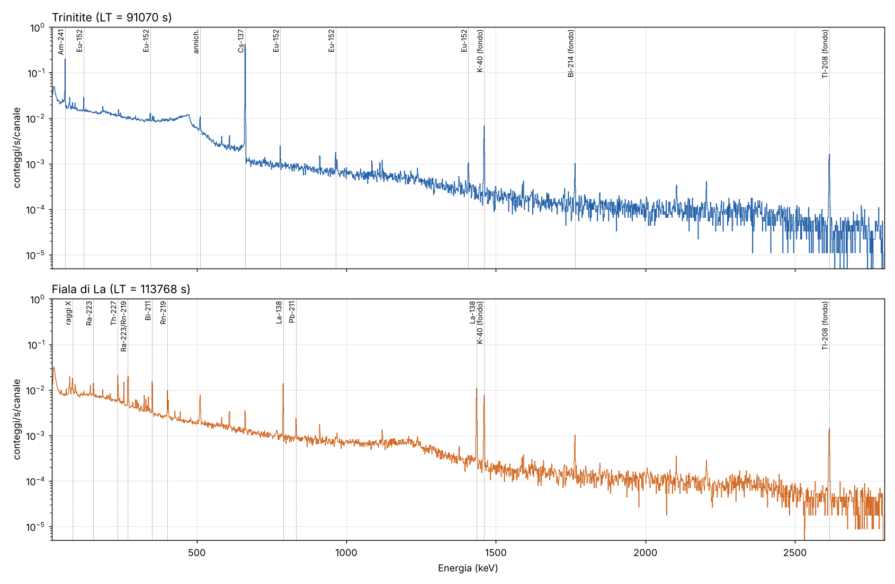

# Analisi di spettri γ HPGe: trinitite e fiala di lantanio

**Spettri analizzati** (GammaVision 6.08, MCA Easy-MCA-2k SN 15043603, 2048 canali, ~1,385 keV/canale, intervallo 0–2840 keV)

| File | Campione | Inizio misura | Live time | Real time | Tempo morto |
|---|---|---|---|---|---|
| `Sabbia_vetrificata_21 ottobre 2026.Spe` | trinitite ("sabbia vetrificata") | 21/10/2026 16:47:45 | 91 070 s (25,3 h) | 91 083 s | ≈0,01 % |
| `Lantan_28 ottobre 2026.Spe` | fiala di lantanio | 28/10/2026 11:04:28 | 113 768 s (31,6 h) | 113 777 s | ≈0,01 % |

Per entrambe le misure **non sono disponibili** una calibrazione in efficienza, uno spettro di fondo dedicato, la massa dei campioni o la geometria di misura. Di conseguenza **non riporto attività assolute (Bq)**. Riporto invece tre cose: (i) l'identificazione dei nuclidi con i relativi tassi netti di conteggio, (ii) i rapporti di attività ottenuti con una *calibrazione in efficienza relativa interna* al campione, (iii) i limiti di rivelabilità per i nuclidi attesi ma non osservati.

---

## 1. Metodo

1. **Calibrazione in energia.** I file contengono la calibrazione di GammaVision (E = −0,050 + 1,38516·ch + 7,3·10⁻⁷·ch²). Usando picchi di riferimento ben noti (²⁴¹Am 59,54; ¹³⁷Cs 661,66; ⁴⁰K 1460,82; ²⁰⁸Tl 2614,51; ²¹¹Bi 351,06; ¹³⁸La 788,74 e 1435,80 keV) l'ho rifittata con un polinomio quadratico: E = 0,193 + 1,38546·ch + 5,34·10⁻⁷·ch² keV. I residui sono ≤ 0,3 keV, cioè ≤ 0,2 canali.
2. **Risoluzione.** Dai picchi isolati ottengo FWHM² = 0,925 + 2,14·10⁻³·E (keV²), cioè 1,5 keV a 662 keV e circa 2,0 keV a 1332 keV, valori tipici di un HPGe coassiale. Con 1,385 keV/canale ogni picco cade però in **solo 1–2 canali** (forte sotto-campionamento). Questo limita la separazione dei doppietti più vicini di circa 1,5 keV (es. ²¹¹Bi 351,06 / ²¹⁴Pb 351,93).
3. **Fit dei picchi.** Ho fittato gaussiane integrate sul canale più un fondo lineare locale, con minimi quadrati pesati iterati (approssimazione della verosimiglianza di Poisson). I multipletti sono fittati simultaneamente. Le energie sono fissate ai valori di libreria, con uno spostamento comune ammesso di ±0,8 keV e una larghezza scalabile tra 0,8 e 1,4 volte la FWHM del modello. Per i nuclidi di ciascun campione ho usato una libreria dedicata, a cui ho aggiunto in entrambi i casi le linee del fondo naturale (serie U/Th, ⁴⁰K) e i raggi X del Pb.
4. **Decisione e limiti.** Ho usato i criteri di Currie: livello critico L_C = 2,33·√B e limite di rivelazione L_D = 2,71 + 4,65·√B, con B il fondo sotto ±3σ del picco. Considero un picco "rivelato" se l'area netta è maggiore di L_C e di 3σ.
5. **Ricerca di picchi non previsti.** Ho fatto una scansione canale per canale (gaussiana più fondo lineare su una finestra di ±6 canali) per cercare eccessi > 4σ non assegnati. Risultati in `log_picchi_non_identificati.txt`: nella trinitite compaiono solo 93 keV (²³⁴Th 92,4/92,8 keV e raggi X, presenti anche nell'altro spettro) e 474 keV (spalla Compton del ¹³⁷Cs a 477 keV). Nella fiala di La compare solo 661,7 keV (vedi §3.4).
6. **Dati nucleari.** Energie e intensità γ sono i valori raccomandati ENSDF/NNDC e DDEP/LNHB, riportati in `script/lib.py`.
7. **Riproducibilità.** Tutti i calcoli sono in `script/` (`cal2.py` → `run2.py` → `quant.py`, `scan.py`, `tabella.py`, `figs.py`). Le tabelle complete dei picchi sono in `picchi_trinitite.csv` e `picchi_fiala_lantanio.csv`.

---

## 2. Trinitite

### 2.1 Nuclidi identificati

| Nuclide | T½ | Linea (keV) [Iγ %] | Tasso netto (mcps) | Significatività | Origine |
|---|---|---|---|---|---|
| **¹³⁷Cs** | 30,08 a | 661,66 [85,1] | 789,1 ± 3,0 | > 250σ | prodotto di fissione |
| **²⁴¹Am** | 432,6 a | 59,54 [35,9] | 197,9 ± 1,6 | > 100σ | decadimento del ²⁴¹Pu del combustibile |
| **¹⁵²Eu** | 13,52 a | 121,78 [28,5] | 15,5 ± 0,6 | 25σ | attivazione neutronica (¹⁵¹Eu(n,γ)) del suolo |
| | | 244,70 [7,6] | 3,0 ± 0,5 | 6σ | |
| | | 344,28 [26,6] | 6,9 ± 0,6 | 12σ | |
| | | 778,90 [12,9] | 2,05 ± 0,21 | 10σ | |
| | | 964,08 [14,5] | 1,69 ± 0,27* | 6σ | (*sottratto ²²⁸Ac 964,8 di fondo) |
| | | 1085,84 [10,1] | 0,99 ± 0,16 | 6σ | |
| | | 1408,01 [20,9] | 1,68 ± 0,18 | 9σ | |
| **¹³³Ba** | 10,55 a | 356,01 [62,1] | 2,08 ± 0,42 | 5σ | attivazione ¹³²Ba(n,γ) |
| | | 302,85 [18,3] | 0,82 ± 0,45 | <2σ (compatibile) | |
| **²³⁹Pu** | 24 110 a | 51,62 [0,0272] | 3,6 ± 0,7 | 5,4σ | combustibile non fissionato |
| | | 129,30 [0,0063] | 1,7 ± 0,5 | 3,1σ | |

Note sull'identificazione:
- Le linee di ¹⁵²Eu a 411,1 e 1112,1 keV non entrano nella quantificazione. La prima ha un'interferenza non risolta, la seconda è nel doppietto con ²¹⁴Bi 1120,3 keV.
- Per il **²³⁹Pu** le due linee più intense, 51,6 e 129,3 keV, sono presenti nella trinitite e **assenti** nello spettro della fiala di La misurato con lo stesso rivelatore. Il rapporto fra le loro intensità è fisicamente coerente: il 129,3 keV atteso, dato il 51,6 keV osservato, è 0,8–1,7 mcps; quello misurato è 1,7 ± 0,5 mcps. Le linee a 375,0 e 413,7 keV (Iγ ≈ 0,0015 %) sono sotto il limite di rivelabilità, come atteso. In letteratura il ²³⁹Pu nella trinitite è osservato in γ ma è "difficile da quantificare per la debolezza del segnale e le interferenze" [3]. Considero quindi l'identificazione **solida** e la quantificazione **indicativa**.
- Per il **¹³³Ba** il 356 keV è a 4 keV dal ²¹⁴Pb 351,9 keV e il fit è multiplo. Le linee secondarie (81, 303, 384 keV) sono compatibili ma singolarmente non significative. L'identificazione è **probabile**, con significatività moderata.

### 2.2 Nuclidi attesi ma non rivelati (coerente con la letteratura)

| Nuclide | T½ | Fattore di decadimento dal 16/07/1945 | Esito |
|---|---|---|---|
| ⁶⁰Co | 5,27 a | 2,3·10⁻⁵ | non rivelato: 1332,5 keV < 0,49 mcps (L_D); A(⁶⁰Co)/A(¹⁵²Eu) < 0,06 |
| ¹⁵⁴Eu | 8,60 a | 1,4·10⁻³ | non rivelato: 1274,4 keV < 0,55 mcps; A(¹⁵⁴Eu)/A(¹⁵²Eu) < 0,17 |
| ¹⁵⁵Eu | 4,75 a | 7·10⁻⁶ | non rivelato (86,5 / 105,3 keV) |

Rispetto al ¹⁵²Eu (fattore 0,0155), dal 1945 il ¹⁵⁴Eu ha perso un ulteriore fattore 0,09 e il ⁶⁰Co un fattore 1,5·10⁻³. Dopo 81 anni la loro assenza è quindi attesa e non dice nulla contro l'origine del campione. Questi nuclidi sono riportati come presenti nei lavori di 20 o più anni fa [1, 2, 4].

### 2.3 Rapporti di attività (calibrazione in efficienza relativa interna con ¹⁵²Eu)

La curva di efficienza relativa è ottenuta dalle 7 linee pulite del ¹⁵²Eu dello stesso campione: ln ε = polinomio di 2° grado in ln E, χ²_rid = 0,6. In questo modo geometria e autoassorbimento sono inclusi automaticamente nella curva.

| Rapporto | Al 21/10/2026 | Riportato al 16/07/1945 (Δt = 81,27 a) |
|---|---|---|
| A(¹³⁷Cs)/A(¹⁵²Eu) | 56 ± 3 | **5,7 ± 0,3** |
| A(¹³³Ba)/A(¹⁵²Eu) | 0,12 ± 0,03 | 0,40 ± 0,08 |
| A(²³⁹Pu)/A(²⁴¹Am) | ≈ 24–34 (indicativo) | — |

Incertezze: sono indicate solo quelle statistiche e di fit. Ci sono due effetti sistematici non quantificabili senza conoscere la geometria:
- la **somma per coincidenza** delle linee in cascata del ¹⁵²Eu (in geometria ravvicinata causa perdite di qualche % fino a circa il 10–20 %; il ¹³⁷Cs non ne è affetto);
- per il rapporto Pu/Am, il rapporto di efficienza ε(51,6)/ε(59,5), che ho assunto tra 0,7 e 1,0.

Il ¹³⁷Cs è corretto per i 4,0 ± 0,3 mcps di ¹³⁷Cs di fondo di laboratorio visti nell'altra misura.

**Interpretazione alla luce della letteratura.**
- La firma (¹³⁷Cs + ¹⁵²Eu + ¹³³Ba + ²⁴¹Am + ²³⁹Pu, senza linee di altri prodotti di fissione a vita breve) è quella tipica della trinitite descritta in letteratura [1–5]: un prodotto di fissione (¹³⁷Cs), prodotti di attivazione neutronica dei materiali del suolo e del dispositivo (¹⁵²Eu, ¹³³Ba), il combustibile Pu e il suo discendente ²⁴¹Am.
- Il ²⁴¹Am deriva in gran parte dal decadimento del ²⁴¹Pu presente nel combustibile e prodotto per cattura neutronica durante l'esplosione [3]. In 49 campioni di trinitite il ²⁴¹Am riportato alla data della detonazione varia fra 1 e 42 Bq/g [5].
- Il ¹³³Ba è attribuito principalmente all'attivazione del bario del Baratol, l'esplosivo convenzionale del dispositivo [3], con un possibile contributo del Ba delle sabbie arcosiche [5].
- Il rapporto ¹³⁷Cs/¹⁵²Eu **non è una costante universale**. Nel suolo è circa 20 volte più basso che nella trinitite tipica, per la lisciviazione del Cs [3]. Inoltre tra i prodotti di attivazione del suolo (¹⁵²Eu, ¹⁵⁴Eu) e i radionuclidi del dispositivo non si osservano correlazioni [5]. Il valore di questo campione va quindi letto come una caratteristica del singolo frammento, che dipende tra l'altro dalla distanza dal ground zero [2], e non come un test di autenticità.

### 2.4 Radionuclidi naturali

Le linee di ⁴⁰K, ²¹⁴Pb/²¹⁴Bi e ²²⁸Ac/²¹²Pb/²⁰⁸Tl compaiono in entrambi gli spettri con tassi simili, quindi sono dominate dal **fondo ambientale**. Rispetto allo spettro della fiala di La, usato come approssimazione del fondo, nella trinitite si vedono eccessi a 185,7 keV (²³⁵U/²²⁶Ra, +2,7 ± 0,7 mcps) e a 238,6 keV (²¹²Pb, +3,2 ± 0,7 mcps). Questi eccessi indicano U e Th nel vetro, compatibili con la sua origine dalla sabbia arcosica. Il ⁴⁰K però risulta *più basso* nella trinitite (−2,6 ± 0,5 mcps): il fondo non era identico nelle due misure. Per questo **non quantifico** il contenuto naturale. Per farlo serve uno spettro di fondo dedicato.

---

## 3. Fiala di lantanio

### 3.1 Contenuto: ¹³⁸La + catena dell'²²⁷Ac

| Nuclide | T½ | Linee osservate (keV) | Tasso netto (mcps) |
|---|---|---|---|
| **¹³⁸La** (La naturale, 0,089 %) | 1,03·10¹¹ a | 788,74 (β⁻ → ¹³⁸Ce) | 18,1 ± 0,4 |
| | | 1435,80 (CE → ¹³⁸Ba) | 19,2 ± 0,4 |
| **²²⁷Th** (catena ²²⁷Ac) | 18,7 d | 235,96 / 256,23 / 329,85 / 210,6 / 286,1 / 304,5 / 334,4 | 22,3 / 12,8 / 3,4 / 2,9 / 1,8 / 1,6 / 1,3 |
| **²²³Ra** | 11,4 d | 269,46 / 154,21 / 323,87 / 338,28 / 144,23 / 445,03 / 122,3 | 22,6 / 9,6 / 5,4 / 4,3 / 6,0 / 1,4 / 1,5 |
| **²¹⁹Rn** | 3,96 s | 271,23 / 401,81 | 20,0 / 8,8 |
| **²¹¹Pb** | 36,1 min | 404,85 / 427,09 / 831,96 | 4,4 / 1,6 / 2,46 ± 0,21 |
| **²¹¹Bi** | 2,14 min | 351,06 | ≈ 19 (corretto per ²¹⁴Pb 351,9) |
| raggi X K | — | ~81–94 keV (Rn/Ra) + Pb Kα/Kβ (schermo) | qualitativo |

Tutte le linee hanno significatività > 5σ, tranne le più deboli (²¹¹Pb 766 keV, ²⁰⁷Tl 897,8 keV), che sono solo compatibili. Nessuna linea della trinitite (²⁴¹Am, ¹⁵²Eu) è presente.

La presenza di ²²⁷Ac nel lantanio è ben documentata. Ac e La sono chimicamente quasi indistinguibili e l'²²⁷Ac (serie del ²³⁵U) segue il La nei minerali e nella purificazione. Il caso tipico è il fondo intrinseco degli scintillatori LaCl₃(Ce) e LaBr₃(Ce) [6–9].

### 3.2 Equilibrio della catena

Con le linee della catena ho costruito una curva di efficienza relativa (ln ε lineare in ln E). Le linee del ²²⁷Th e quelle del ²²³Ra stanno sulla stessa curva entro circa il 10–20 % (residui per linea in `log_quantificazione.txt`), senza uno scarto sistematico fra le due famiglie. Il ²¹⁹Rn (401,8 keV) è anch'esso in linea, quindi non si vede una perdita apprezzabile di Rn dalla fiala. Il dato è compatibile con l'**equilibrio secolare** ²²⁷Ac–²²⁷Th–²²³Ra–figli. Ne segue che il materiale è stato separato chimicamente da almeno alcuni mesi (circa 5–10 volte i 18,7 d del ²²⁷Th).

### 3.3 Livello di contaminazione da ²²⁷Ac

Assumo che il lantanio sia di composizione isotopica naturale. In quel caso il ¹³⁸La fa da **riferimento interno**: abbondanza 0,08881 %, T½ = 1,03·10¹¹ a, quindi un'attività specifica di **0,82 Bq per grammo di La**. Le efficienze a 789 keV (¹³⁸La) e a 832 keV (²¹¹Pb) differiscono solo di circa il 5 %, per cui il confronto diretto è quasi indipendente dalla geometria:

- A(²²⁷Ac)/A(¹³⁸La) = **1,38 ± 0,12** (²¹¹Pb 832 keV contro ¹³⁸La 789 keV);
- usando l'intera catena e la curva di efficienza relativa si ottiene 1,69 ± 0,19. La differenza dà un'idea dell'incertezza sistematica.

Quindi:
- **²²⁷Ac ≈ 1,1–1,4 Bq per grammo di La**;
- rapporto atomico **Ac/La ≈ (2,6–3,2)·10⁻¹³**.

Per confronto, la letteratura riporta 1,3·10⁻¹³ atomi della catena ²²⁷Ac per atomo di La in uno dei primi cristalli di LaCl₃(Ce), e 5,8·10⁻¹⁵ in un LaBr₃(Ce) moderno [9]. Il lantanio della fiala ha quindi un livello di ²²⁷Ac **paragonabile a quello dei materiali non specificamente purificati dall'attinio**.

Verifica di coerenza: il rapporto osservato tra i tassi del ¹³⁸La, corretto per le intensità, ε(1436)/ε(789) = 0,56, è inferiore all'estrapolazione della curva della catena (0,73). La discrepanza si spiega con la curvatura della curva di efficienza al di sopra di 850 keV e con la perdita per somma del 1436 keV con i raggi X K del Ba emessi dopo la cattura elettronica. Per questo motivo per il rapporto Ac/La uso solo la linea a 789 keV.

### 3.4 ¹³⁷Cs nello spettro della fiala

A 661,7 keV c'è un picco di 4,0 ± 0,3 mcps. **Non** proviene da frammenti di trinitite rimasti sul rivelatore. In quel caso si vedrebbe anche il ²⁴¹Am a 59,5 keV, atteso intorno a 1 mcps (rapporto 59,5/662 della trinitite circa 0,25), mentre se ne misurano −0,6 ± 0,3. L'origine più probabile è il fondo di laboratorio, cioè sorgenti nelle vicinanze o il fallout nei materiali. Un contributo della fiala non si può escludere senza una misura di fondo.

---

## 4. Conclusioni

1. **Trinitite**: contiene ¹³⁷Cs (dominante), ²⁴¹Am, ¹⁵²Eu, ¹³³Ba e ²³⁹Pu (identificato tramite le linee a 51,6 e 129,3 keV), più tracce di U/Th naturali. ⁶⁰Co, ¹⁵⁴Eu e ¹⁵⁵Eu non sono rivelabili, come atteso dopo 81 anni di decadimento. Lo spettro è pienamente compatibile con la trinitite del test Trinity (16/07/1945) descritta in letteratura. Rapporti principali, riportati al 1945: A(¹³⁷Cs)/A(¹⁵²Eu) = 5,7 ± 0,3 (stat.) e A(¹³³Ba)/A(¹⁵²Eu) = 0,40 ± 0,08.
2. **Fiala di La**: contiene lantanio naturale (¹³⁸La, 788,7 e 1435,8 keV) contaminato da **²²⁷Ac in equilibrio con i figli** (²²⁷Th, ²²³Ra, ²¹⁹Rn, ²¹¹Pb, ²¹¹Bi). Il livello è A(²²⁷Ac)/A(¹³⁸La) ≈ 1,4–1,7, cioè circa 1,1–1,4 Bq di ²²⁷Ac per g di La, ovvero Ac/La ≈ 3·10⁻¹³ in atomi.

## 5. Limiti e misure consigliate

- **Fondo**: serve uno spettro a vuoto della stessa durata (≥ 1 giorno) per sottrarre correttamente ⁴⁰K, U/Th e il ¹³⁷Cs di laboratorio.
- **Efficienza assoluta**: con una sorgente multi-γ certificata nella stessa geometria, oppure con calcolo Monte Carlo/LabSOCS, e con la massa dei campioni, i rapporti diventano attività in Bq/g. Se si conosce la **massa di La nella fiala**, il ¹³⁸La fornisce da solo una calibrazione assoluta dell'efficienza a 789 e 1436 keV per quella geometria.
- **Guadagno/canali**: 2048 canali su 2,8 MeV sotto-campionano i picchi. Conviene acquisire con 8192 o 16384 canali.
- **Pu**: per quantificare ²³⁹⁺²⁴⁰Pu in modo affidabile serve la spettrometria α dopo separazione radiochimica, come in [1, 4].

## Bibliografia

1. P.P. Parekh, T.M. Semkow, M.A. Torres et al., *Radioactivity in Trinitite six decades later*, J. Environ. Radioact. 85 (2006) 103–120. [ADS](https://ui.adsabs.harvard.edu/abs/2006JEnvR..85..103P)
2. F. Belloni, J. Himbert, O. Marzocchi, V. Romanello, *Investigating incorporation and distribution of radionuclides in trinitite*, J. Environ. Radioact. 102 (2011) 852–862. [JRC](https://publications.jrc.ec.europa.eu/repository/handle/JRC67348)
3. *Gamma and Decay Energy Spectroscopy Measurements of Trinitite*, Nucl. Technol. (2021), arXiv:2103.06240 (gruppo con affiliazione NIST Boulder). [arXiv](https://arxiv.org/abs/2103.06240), [PMC](https://pmc.ncbi.nlm.nih.gov/articles/PMC8628553)
4. *Measurements of radioactive gamma emitters in trinitites*. [CORE](https://core.ac.uk/works/146279469)
5. Gamma spectrometry of 49 bulk trinitite samples (¹³³Ba, ¹³⁷Cs, ¹⁵²Eu, ¹⁵⁴Eu, ¹⁵⁵Eu, ²³⁹Pu, ²⁴¹Am), J. Radioanal. Nucl. Chem. 295 (2013) 2049–2057, doi:10.1007/s10967-012-2201-4. [Springer](https://link.springer.com/doi/10.1007/s10967-012-2201-4)
6. J.K. Hartwell, R.J. Gehrke, *Observations on the background spectra of four LaCl₃(Ce) scintillation detectors*, Appl. Radiat. Isot. 63 (2005) 223–228.
7. B.D. Milbrath et al., *Characterization of alpha contamination in lanthanum trichloride scintillators using coincidence measurements* (PNNL, 2005). [PNNL](https://www.pnnl.gov/publications/characterization-alpha-contamination-lanthanum-trichloride-scintillators-using)
8. PNNL-15453, *Contamination in LaCl₃:Ce scintillators*. [PDF](https://www.pnnl.gov/main/publications/external/technical_reports/PNNL-15453.pdf)
9. *Intrinsic radiation background of LaBr₃(Ce) detector via coincidence measurements and simulations*, arXiv:2007.07552. [arXiv](https://arxiv.org/abs/2007.07552)
10. Dati di decadimento del ¹³⁸La: ENSDF/NNDC ([adopted levels](https://www.nndc.bnl.gov/ensnds/138/La/adopted.pdf)); DDEP (Bé et al.), branching CE 65,2(6) % / β⁻ 34,8(6) %, citato in [TU Delft](https://repository.tudelft.nl/file/File_9efc9432-33af-4fb1-9710-144de91c8fcc).
11. Energie e intensità γ: NNDC/ENSDF (NuDat) e DDEP/LNHB *Recommended Data*.

*Nota sulle fonti*: dalla rete di questa sessione non è stato possibile scaricare i testi integrali di [1–5]. Le affermazioni attribuite a questi lavori si basano sugli abstract e sui record indicizzati. Per questo non riporto confronti numerici con le loro tabelle di attività.
