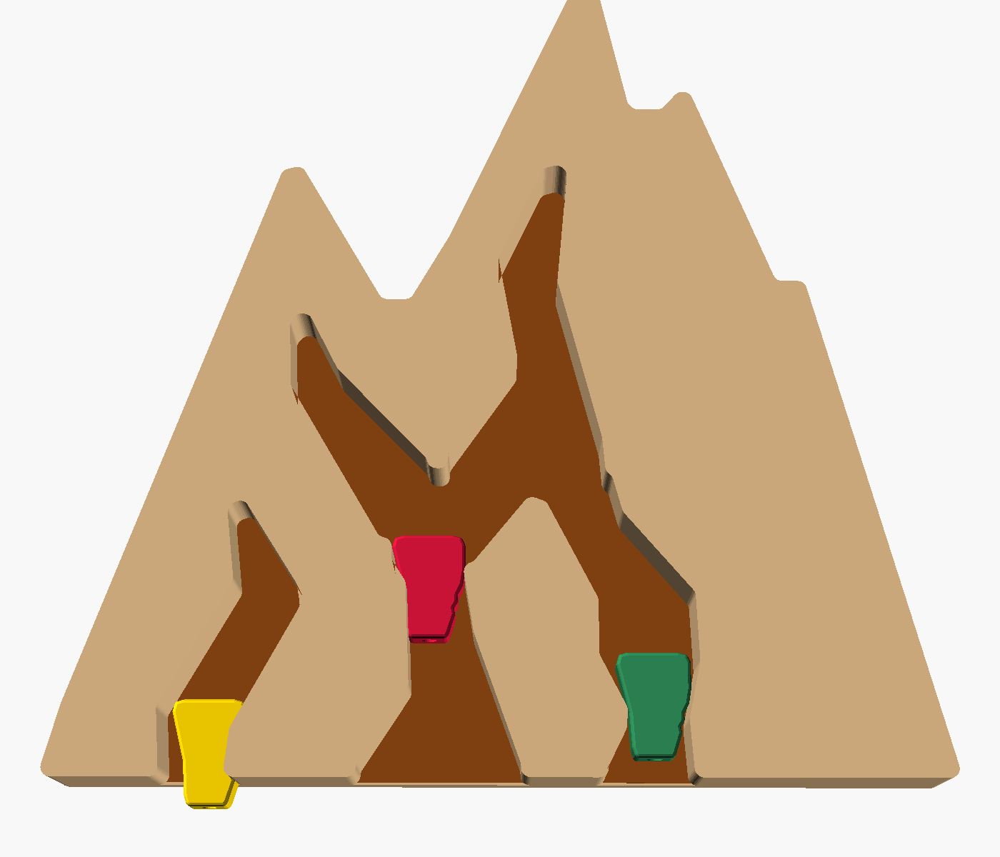

# Portachiavi "montagna" per Natz (stampa 3D)

Portachiavi da muro a forma di montagna con 2 canalature "da arrampicata".
Ogni chiave è appesa a un **nut** colorato che si incastra dove la canalatura si
stringe, come un nut vero in una fessura di roccia. La sagoma e le canalature
sono ricalcate dalla foto di riferimento, senza scritte né logo e senza la
canalatura del nut blu e il picco di destra.



## File

| File | Cosa |
|---|---|
| `portachiavi.scad` | modello parametrico OpenSCAD (misure nel Customizer) |
| `stl/base.stl` | la montagna, 114 × 107 × 13 mm |
| `stl/nut.stl` | un nut |
| `stl/nut_x3.stl` | 3 nut sul piatto (se li fai dello stesso colore) |
| `stl/prova.stl` | pezzetto di base per provare l'incastro di un nut |

Rigenerare gli STL dopo una modifica:

```bash
openscad -D 'parte="base"' -o stl/base.stl portachiavi.scad
```

```bash
openscad -D 'parte="nut"' -o stl/nut.stl portachiavi.scad
```

## Stampa

Ingombro 114 × 107 mm: ci sta su qualsiasi stampante.

- **Base**: PLA effetto legno (o PLA marrone chiaro), stampata **col retro sul
  piatto** così com'è nello STL. Nessun supporto: le canalature sono aperte verso
  l'alto e le tasche delle viti sono ponti da 10 mm. Layer 0.2 mm, 3 perimetri,
  infill 15 %.
  Per avere il fondo scuro come l'originale: filamento marrone scuro per i primi
  3 mm, poi cambio filamento (pausa al layer a 3 mm) e il resto in legno chiaro.
  I fianchi sono dritti come il legno tagliato dell'originale; gli angoli in
  pianta sono arrotondati.
- **Nut**: piastrine spesse 5 mm col profilo dei nut della foto (lato concavo,
  due scalini sull'altro lato). 3 colori (giallo, rosso, verde), stampati in
  piedi con il lato stretto sul piatto. Nessun supporto, 100 % infill. Se
  tendono a staccarsi dal piatto, usa un brim.

## Montaggio dei portachiavi

Per ogni nut:

1. Cavetto d'acciaio Ø 1.5 mm, ~18 cm (oppure cordino Ø 1.5-2 mm).
2. Infilalo dal basso nel foro del nut e bloccalo in cima con una ghiera da
   crimpare (o un nodo, se usi il cordino).
3. In basso infila l'anello portachiavi e chiudi il cappio con una ghiera +
   guaina termorestringente nera, come nella foto originale.

## Fissaggio a muro

Due asole a buco di serratura sul retro, interasse 56 mm: due viti con testa
Ø ≤ 7 mm (es. 3 × 25 + tassello), lasciate sporgere ~2.5 mm. Appoggia e abbassa.

## Uso

Appoggia il nut nella parte larga della canalatura, col lato largo in alto, e
tiralo giù: si blocca dove la canalatura si stringe. Per toglierlo spingilo su.

## Da provare prima

Le misure dei nut vengono dalle proporzioni della foto. Prima di stampare la base
intera, stampa un nut e `stl/prova.stl`: è il pezzetto di base attorno al nut
rosso, 23 × 28 mm, e si stampa in pochi minuti. Se il nut passa o resta troppo in
alto, cambia `nut_altezza` nel Customizer (il profilo si scala tutto insieme) e
ristampa solo i nut: la base resta uguale.
