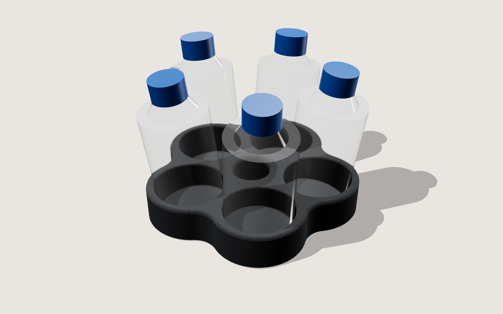

# COROLLA — portaflaconi per 5 flaconi (Ø40 × 70 mm) · Creality K2, PETG-CF

Cinque flaconi in cerchio, ognuno inclinato di 7° verso l'esterno: il gruppo si apre come una
corolla. Il corpo è un pentalobo morbido che abbraccia ogni flacone, con un vuoto al centro.
Si prende da qualsiasi lato, occupa poco spazio sul banco e non ha un "davanti".

- 129 × 126 × 22 mm, 123 cm³ pieni (con infill al 10–15 % sono pochi grammi)
- Fori Ø42 (gioco 1 mm per lato); tasche inclinate profonde circa 18 mm
- Raccordi concavi R14 tra i lobi, bordo superiore R2, imbocco dei fori R1 (orizzontale)
- Linea d'ombra alla base: smusso rientrante di 1,2 mm a 45°, senza supporti
- Il lobo è dimensionato sul punto critico (il bordo esterno in alto, dove la tasca inclinata
  si avvicina alla parete): lì restano comunque 1,5 mm di piano più i raccordi

Parametrico in `genera.py` (`INCLINA`, `H`, `D_CENTRO`, `R_VITA`…) — `pip install manifold3d trimesh`.

## Stampa (Creality Print, PETG-CF)
- Ugello temprato 0,4, layer 0,2 (0,12–0,16 con layer adattivi per raccordi più lisci)
- 250–260 °C, piatto 70–80 °C, ventola 20–40 %
- 3 perimetri, 5 strati superiori, gyroid 10–15 %, **stiratura** sulla faccia superiore
- Nessun supporto. Cucitura "allineata" su un lobo, o "dietro"
