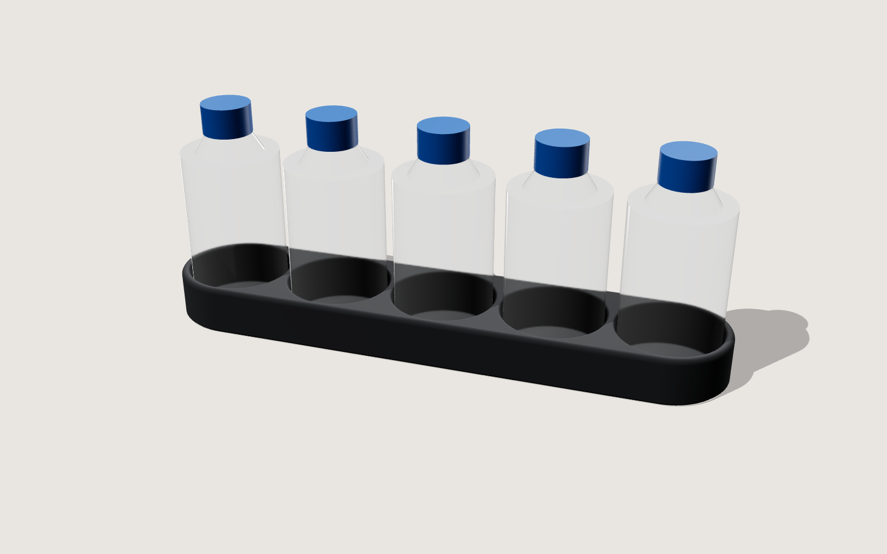

# Rastrelliera 5 flaconi (Ø40 × 70 mm) — Creality K2, PETG-CF

Una forma sola: una capsula bassa e continua, 231 × 49 × 20 mm, 88 cm³.
Nessuna scritta, nessuna tacca, nessun foro a vista — solo cinque cavità.

- Fori Ø42 (gioco 1 mm per lato), tasche profonde 18,4 mm, fondo pieno 1,6 mm
- Pareti uniformi da 3,5 mm: esterne e tra i fori hanno lo stesso spessore
- Bordo superiore raccordato R2, imbocco dei fori raccordato R1,2
- Linea d'ombra alla base: smusso rientrante 1,2 mm a 45° — il pezzo sembra sospeso;
  si stampa senza supporti e fa anche da anti "zampa d'elefante"

Parametrico in `genera.py` (`pip install manifold3d trimesh`).

## Stampa (Creality Print, PETG-CF)
- Ugello temprato 0,4 (o 0,6), layer 0,2 mm — 0,16 per raccordi più lisci
- 250–260 °C, piatto 70–80 °C, ventola 20–40 %
- 3 perimetri, 5 strati superiori, gyroid 10–15 %, **stiratura** sulla faccia superiore
- Nessun supporto; filamento asciugato (65 °C, 6–8 h)
- Cucitura: "posteriore" o "allineata", così la faccia frontale resta pulita
