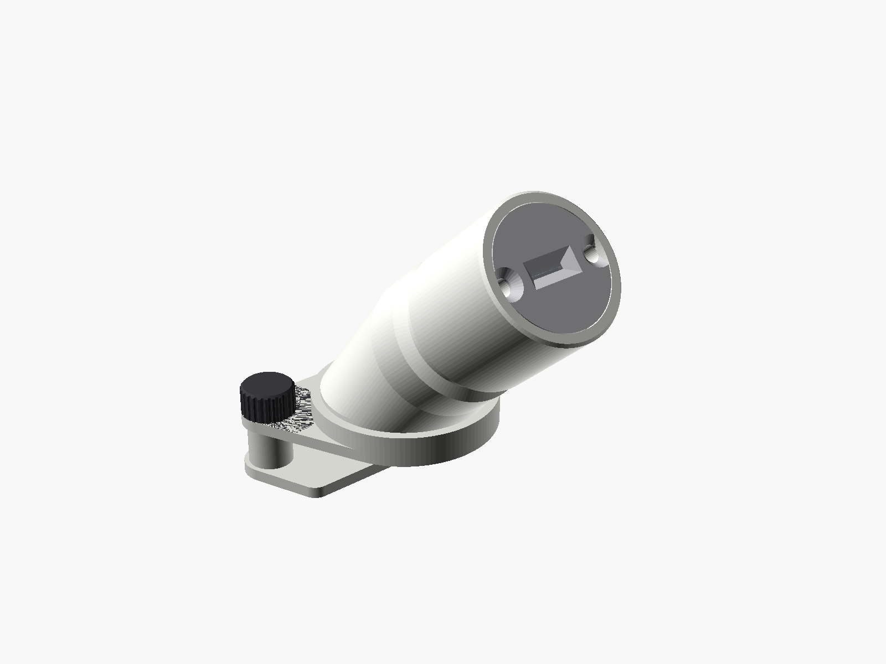
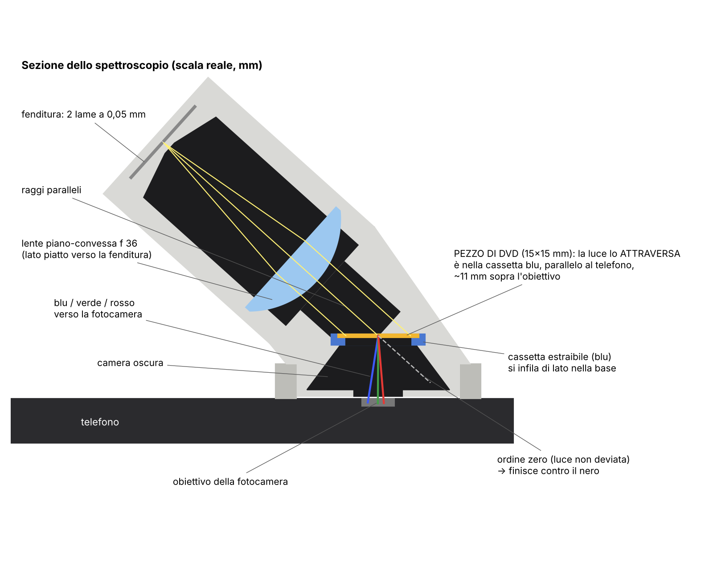
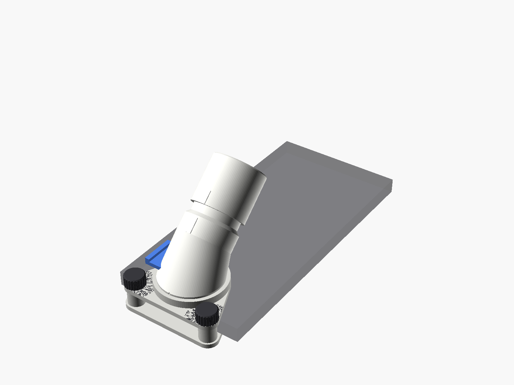
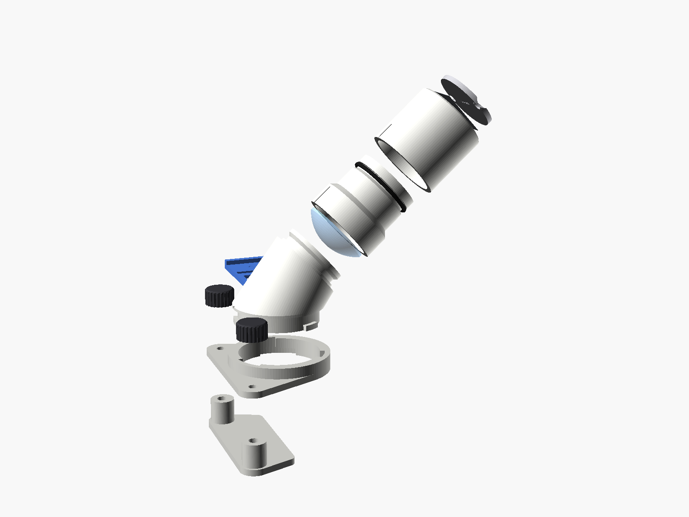
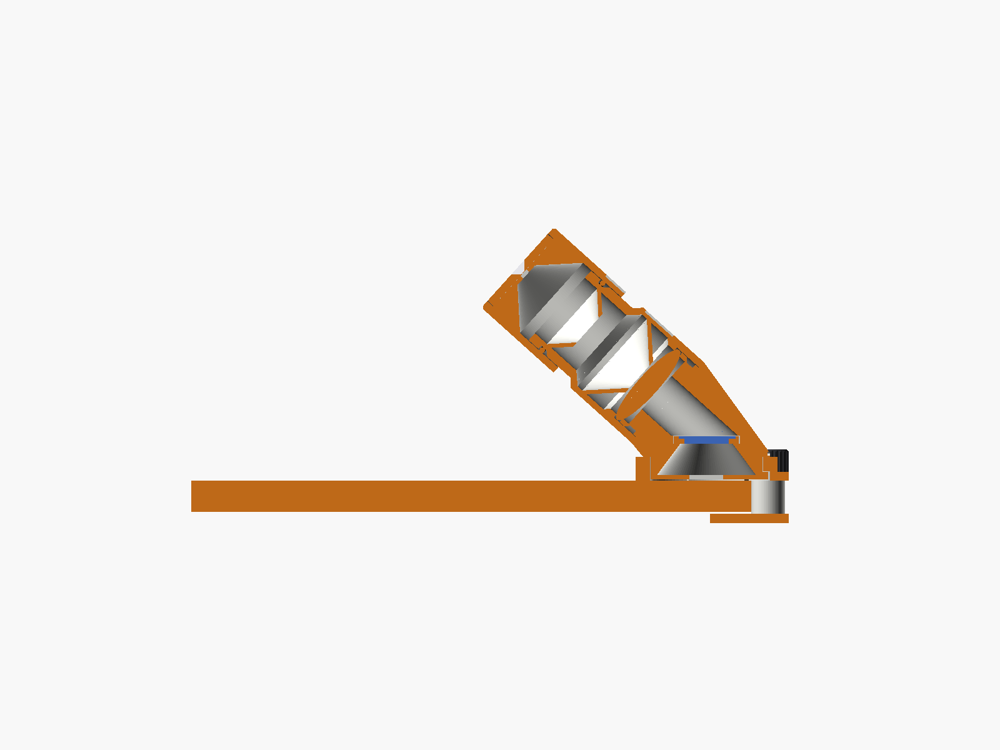
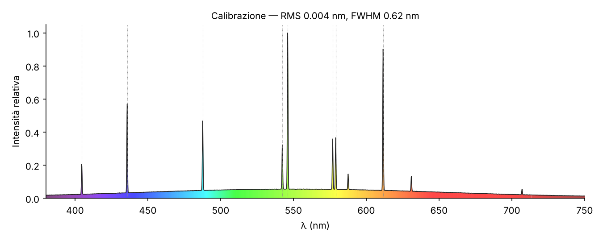

# Spettroscopio per smartphone — reticolo DVD/CD, stampa 3D in PETG

Strumento da agganciare alla fotocamera di uno smartphone. È progettato per lavorare come un
vero spettrometro (fenditura → collimatore → reticolo → obiettivo del telefono a fuoco
all'infinito), non come un tubo di cartone con un pezzo di CD. Il modello è interamente
parametrico ([`spettroscopio.scad`](spettroscopio.scad)): l'angolo del tubo viene ricavato
dall'equazione del reticolo, quindi lo stesso file genera la versione DVD e quella CD.





| | |
|---|---|
|  |  |
|  |  |

**Prestazioni attese (DVD-R, fenditura 50 µm, camera principale da 12 MP):**
380–750 nm in un'unica inquadratura, 0,13 nm/pixel e risoluzione limitata dalla fenditura
di circa 0,7 nm (lente da 36 mm). Nella pratica ci si aspettano 0,7–1,2 nm FWHM, perché si sommano la
cromatica della lente singola e la messa a fuoco. Il doppietto del sodio (0,6 nm) è il test
di riferimento.
Plastica: circa 35 cm³ di pieno, cioè circa 30 g di PETG con riempimento al 15%. Ferramenta:
4 inserti M3, 4 viti, 2 O-ring.

---

## 0. Come funziona, in breve

1. **Fenditura.** La luce entra da una fessura larga 50 µm fra due lame. Ogni riga dello
   spettro finale sarà un'immagine di questa fessura: più è stretta, più le righe sono
   sottili, cioè più risoluzione.
2. **Collimatore.** La fessura sta esattamente nel fuoco della lente: i raggi che escono da
   ogni punto della fessura diventano paralleli. Il telefono, messo a fuoco all'infinito, li
   riporta a fuoco sul sensore. Un tubo senza lente non funziona bene perché il telefono non
   mette a fuoco a pochi centimetri.
3. **Reticolo.** Il DVD ha tracce a spirale distanti 0,74 µm. In trasmissione si comporta
   come un reticolo di diffrazione: devia ogni colore di un angolo diverso
   (sin β = λ/d − sin α). Il blu esce a −9°, il verde dritto, il rosso a +12°.
4. **Camera.** L'obiettivo trasforma ogni angolo in una posizione sul sensore: lo spettro
   diventa una striscia colorata lunga circa 3000 pixel, con righe verticali dove la sorgente
   emette righe.
5. **Calibrazione.** Una lampada fluorescente ha righe a lunghezze d'onda note (mercurio a
   435,8 e 546,1 nm, europio a 611,6 nm). Il software le riconosce e ricava la relazione
   pixel → nanometri; da lì misura qualsiasi altra sorgente o l'assorbimento di un campione.

Il tubo è inclinato di 48° perché la luce deve arrivare obliqua sul reticolo: così il verde
esce esattamente lungo l'asse della camera e lo spettro cade al centro dell'immagine,
mentre la luce non deviata (ordine zero) finisce fuori campo, in una trappola nera.

---

## 1. Stato dell'arte: cosa esiste e cosa abbiamo imparato

| Progetto | Ottica | Cosa insegna |
|---|---|---|
| Public Lab, *Foldable Mini-Spectrometer* | Carta, DVD-R in trasmissione, fenditura in carta | È il riferimento didattico. Gli autori stessi lo definiscono fragile e con un allineamento al telefono «difficile da mantenere». Una fenditura stampata da 0,28 mm è troppo larga; con nastro di alluminio si arriva a ~5 nm FWHM. |
| RSC, *Make a DVD smartphone spectrometer* | DVD-R, solo lo strato trasparente | Le tracce vanno orientate parallele alla fenditura (bordo del disco in alto o in basso). |
| Arxiv 1805.05464 (spettrometro stampato in 3D) | Fenditura da ~30 µm misurata al microscopio, baffle contro la luce diffusa, corpo da 80 mm | Con un reticolo da 1200 l/mm arriva a 0,4 nm. Fenditura stretta e baffle contano più di tutto il resto. |
| Arxiv 1910.12616 (papercraft ad alta risoluzione) | Fenditura a lama | È l'immagine della fenditura sul sensore a fissare la risoluzione. Le fenditure di carta superano 1 mm; con una lama si scende a ~20 µm. |
| Theremino Spectrometer | Webcam + DVD | HD-DVD e Blu-ray non si possono usare (passo troppo fine). Il limite pratico è circa 1 nm per fuoco e imprecisioni, anche se il campionamento è a 0,2 nm/px. |
| ACS Sensors 2016 (DVD + smartphone) | DVD in trasmissione | Il passo reale misurato è 710 ± 19 nm: va calibrato, non dato per scontato. |
| MakerWorld 1459435, NIH 3D Print Exchange, Instructables, Univ. Leiden | Corpi stampati, cuneo di DVD, periscopio | Sono soluzioni con il corpo stampato, ma quasi tutte senza collimatore e senza una fenditura regolabile. Il periscopio di Leiden mostra che pezzi a incastro chiusi abbattono la luce diffusa. |

**Problemi ricorrenti nei modelli esistenti, e come li risolve questo progetto:**

1. **Fuoco.** Lo smartphone non mette a fuoco una fenditura a 5–8 cm (la distanza minima
   di messa a fuoco è 10–20 cm). Con una pupilla di 3,4 mm, una fenditura a 9 cm e il fuoco
   a 15 cm il defocus sfoca di circa 90 µm sul sensore, cioè più di 10 nm.
   → Qui c'è un **collimatore**: la fenditura sta nel fuoco di una lente da 36 mm e il
   telefono lavora a infinito, dove mette a fuoco perfettamente.
2. **Fenditura.** Stampata o in carta è troppo larga e irregolare.
   → **Due lame da rasoio** serrate da un disco con due viti in inserti M3. La larghezza
   (25–100 µm) si imposta con uno spessimetro.
3. **Allineamento al telefono.** Elastici e clip non danno ripetibilità.
   → Morsetto con **due perni cilindrici in appoggio sul bordo superiore del telefono**
   (riferimento a due punti) e **piastra rigida sul dorso** (riferimento piano). Lo
   spettroscopio si aggancia a **baionetta** asimmetrica, che entra in un solo verso.
4. **Luce diffusa.** Interni a imbuto (baffle a 45°), diaframma d'apertura e
   **trappola per l'ordine zero**.
5. **Stampabilità.** Ogni pezzo ha l'orientamento di stampa previsto e **nessun supporto**.
   Il controllo è automatico: sbalzi oltre 45° solo su due piccoli ponti, vedi §5.

---

## 2. Progetto ottico

### 2.1 Geometria
Il reticolo è **parallelo al sensore**, appena sopra l'obiettivo. La luce collimata arriva
con incidenza α tale che la lunghezza d'onda centrale λc esca lungo l'asse della camera:

```
d · (sin β − sin α) = m λ ,   β(λc) = 0  ⇒  α = asin(λc / d)
```

| | DVD-R (d = 740 nm, 1351 l/mm) | CD-R (d = 1600 nm, 625 l/mm) |
|---|---|---|
| Inclinazione del tubo α | **48,0°** | **20,1°** |
| β a 380 / 435,8 / 546,1 / 611,6 / 700 / 750 nm | −13,3 / −8,9 / −0,3 / +4,8 / +11,7 / +15,7° | −6,1 / −4,1 / −0,1 / +2,2 / +5,4 / +7,2° |
| 2° ordine (inizio a 380 nm) | +16,5°, fuori dall'intervallo del 1° ordine ✔ | +7,5°: tocca il 1° ordine oltre 740 nm |
| Ordine zero | a 48°, fuori dal campo visivo (±34°) e intrappolato | a 20°, nel campo ma lontano dallo spettro |
| Dispersione sul sensore (f = 5,7 mm) | 7,7 µm/nm → 0,13 nm/px | 3,6 µm/nm → 0,28 nm/px |

Lo spettro 380–750 nm (DVD) occupa ±15° di campo, circa 3 mm sul lato lungo del sensore,
cioè ~2950 px su 4032. La dispersione è orientata lungo l'asse lungo del telefono, che
coincide con il lato lungo del sensore.

### 2.2 Bilancio di risoluzione
Immagine della fenditura sul sensore:
`w' = w · f_cam / f_col · cos α / cos β`. Il fattore anamorfico cos α = 0,67 del montaggio
DVD **restringe** l'immagine.

| Fenditura | DVD: w' / limite fenditura | CD: w' / limite fenditura |
|---|---|---|
| 25 µm | 2,1 µm / **0,28 nm** | 3,0 µm / 0,83 nm |
| 50 µm (consigliata) | 4,2 µm / **0,55 nm** (f_col 45) · 5,3 µm / **0,69 nm** (f_col 36) | 5,9 µm / 1,67 nm |
| 100 µm | 8,5 µm / 1,10 nm | 11,9 µm / 3,3 nm |

Altri contributi:
- **Diffrazione:** con circa 4600 solchi illuminati dalla pupilla della camera,
  R = λ/Δλ ≈ 4600, cioè 0,12 nm. Trascurabile.
- **Cromatica della lente singola in PMMA** (V ≈ 57): Δf ≈ 1,6 mm fra 400 e 700 nm.
  Mettendo a fuoco a 550 nm restano ±0,8 mm ai bordi, cioè circa 1 nm di allargamento agli
  estremi. Si elimina con un **doppietto acromatico** Ø25 f ≈ 40–50 (vedi §8).
- **Campionamento Bayer:** circa 2 µm per canale, 0,26 nm. Usare la somma dei canali o
  il RAW.

Gli angoli sono stati verificati con un ray-trace sulle mesh STL reali: fascio entrante
Ø8 con campo ±3,8°, raggi uscenti dalla pupilla Ø4 per 380–750 nm.
**Vignettatura 0%** su tutto l'intervallo. L'ordine zero cade a y = 5–17 mm, fuori dalla
finestra (|y| < 4,5 mm).

### 2.3 Componenti ottici
- **Collimatore (default):** lente **piano-convessa in borosilicato Ø25 mm, f = 36 mm,
  spessore 6,5 mm** (PATIKIL "Convex Lens 25 mm OD", Amazon.it, 8 pezzi ~16 €), montata con
  il **lato piatto verso la fenditura**: è l'orientamento che minimizza l'aberrazione
  sferica per una sorgente puntiforme nel fuoco. Dai dati (n = 1,474) il modello ricava
  R = 17,1 mm, sporgenza 5,45 mm, bordo 1,05 mm e distanza focale anteriore 31,6 mm. La
  faccia piana poggia su una battuta (riferimento assiale); il lato curvo tocca uno spigolo
  circolare del perno della base (contatto tangente, come negli obiettivi). In alternativa
  va bene una lente Cardboard biconvessa Ø25 f45 (`lens_type="bcx"`, `lens_n=1.49`,
  `lens_ct=5.6`, `lens_f=45`). È seguita da un **diaframma Ø8** che usa solo il centro della
  lente: meno aberrazione sferica, meno luce diffusa.
- **Baffle:** un imbuto nel collo del tubo e il cono interno del cappuccio, entrambi a 45°
  e quindi stampabili senza supporti.
- **Reticolo:** un quadrato da 15×15 mm di DVD-R vergine, solo il semidisco trasparente con
  il *pregroove*, montato in una **cassetta estraibile** con una freccia incisa per
  l'orientamento delle tracce.

---

## 3. Parti

| # | Parte (`part=`) | Orientamento di stampa | Pieno | Inserti / ferramenta |
|---|---|---|---|---|
| 1 | `base` — naso: baionetta, camera oscura, sede cassetta, perno lente con O-ring | faccia telefono sul piatto | 13,1 cm³ | O-ring 22×1,5 |
| 2 | `tube` — collimatore: sede lente, stop Ø8, baffle, collo di fuoco | estremità fenditura in basso | 5,3 cm³ | O-ring 22×1,5 |
| 3 | `cap` — cappuccio fenditura: fuoco ±3 mm e rotazione a frizione | manicotto in basso | 7,1 cm³ | **2× inserto M3×4** |
| 4 | `slit_plate` — disco di serraggio lame | faccia esterna sul piatto | 0,8 cm³ | 2× M3×6 svasata ISO 10642 |
| 5 | `cassette` — porta-reticolo estraibile | piatta | 0,8 cm³ | — |
| 6 | `back_plate` — piastra sul dorso e anello baionetta | lato telefono sul piatto | 3,5 cm³ | — |
| 7 | `jaw` — ganascia lato schermo con 2 perni di riferimento | lastra giù, perni su | 3,5 cm³ | **2× inserto M3×4** |
| 8 | `knob` ×2 — pomelli | testa sul piatto | 0,5 cm³ | 2× M3×8 ISO 4762 (testa piantata a pressione) |

Tutti gli STL sono in [`stl/`](stl/), già orientati per la stampa e verificati: chiusi
(*watertight*), un solo corpo per pezzo, `zmin = 0`.

**Design:** forme ridotte all'essenziale. Il cappuccio, il tubo e la faccia d'appoggio
della base hanno lo **stesso diametro di 29 mm** e le giunzioni sono linee sottili. Gli
spigoli hanno smussi da 0,6 mm. Il disco della fenditura è a filo con la faccia del
cappuccio, quindi sulla testa si vedono solo un cerchio, una riga e due viti svasate. Non
ci sono viti visibili sul corpo: tubo e cappuccio sono tenuti da O-ring, come i barilotti
degli obiettivi. Si usa un solo materiale e un solo colore.

---

## 4. Distinta materiali (indicativa)

| Componente | Q.tà | Note | ~€ |
|---|---|---|---|
| PETG **nero opaco** | ~30 g | Il nero non è estetico ma necessario: con 1,6 mm di parete un PETG chiaro lascia passare luce. Prova con una torcia. | 0,70 |
| Inserti a caldo M3×4 (Ruthex, CNC Kitchen o equivalenti) | 4 | foro Ø4,0 mm, cieco, profondo 5 mm, senza smusso (parametri `ins_d`, `ins_l`) | 0,40 |
| Viti M3×8 ISO 4762 | 2 | per i pomelli | 0,10 |
| Viti M3×6 svasate ISO 10642 | 2 | disco della fenditura | 0,10 |
| O-ring NBR 22×1,5 mm | 2 | frizione del fuoco e trattenimento del tubo | 0,20 |
| Lente piano-convessa Ø25 f36, borosilicato | 1 | PATIKIL 8 pz (~16 €, ne avanzano 7); misura spessore e focale e aggiorna `lens_ct`/`lens_f` | 2,00 |
| Lame da rasoio bilama (0,10 mm) | 1 | se ne ricavano 2 pezzi da 14×9 mm con un filo ciascuno | 0,20 |
| DVD-R vergine | 1 | da un disco si ricavano decine di reticoli | 0,30 |
| Feltro adesivo 1 mm | 5 cm² | sulla ganascia lato schermo | 0,10 |
| **Totale** | | | **≈ 5 €** |

---

## 5. Stampa (PETG)

- Ugello 0,4 mm, strato 0,2 mm (0,12 mm per `cap` e `slit_plate` se vuoi superfici più
  pulite).
- **3 perimetri, 4 strati superiori e 4 inferiori, gyroid al 15%.** La rigidità dei pezzi
  ottici viene dai perimetri, non dal riempimento.
- 235–245 °C, piatto a 75–85 °C, ventola al 40–60% (serve per gli sbalzi a 45°).
- **Nessun supporto.** Gli unici sbalzi orizzontali sono la corona della spalla della
  baionetta (2 mm) e il ponte sopra la sede della cassetta (17,8 mm). Entrambi si stampano
  bene in PETG con un buon raffreddamento.
- Tolleranze: il gioco radiale di default è `fit = 0.15`. Stampa prima `cassette` e `knob`
  per tarare la stampante. La compressione degli O-ring è progettata al 13% circa:
  se il fuoco è troppo duro o troppo morbido, ritocca `fit` di ±0,05.
- Inserti: saldatore a 220–230 °C, inserto dritto e a filo. Il PETG fluisce bene; lascia
  raffreddare senza muoverlo.

---

## 6. Montaggio

1. **Reticolo.** Separa le due metà del DVD-R infilando una lama sul bordo. Prendi la metà
   trasparente con i solchi; se ha il colorante, lavala con acqua o alcol. **Prima di
   tagliare segna la direzione tangente** delle tracce. Taglia un quadrato 15×15 mm vicino
   al bordo esterno (r ≈ 50 mm, dove le tracce sono più dritte). Fissalo nella cassetta con
   due punti di colla UV o kapton ai bordi, con **le tracce parallele alla freccia**. Non
   toccare la zona centrale.
2. **Fenditura.** Metti i due pezzi di lama nel vano con i fili affacciati e uno spessimetro
   da 0,05 mm (oppure due strati di alluminio da cucina, circa 0,03 mm) fra i fili. Appoggia
   il disco, stringi le due M3×6 e sfila lo spessimetro. Controlla controluce con la
   modalità macro del telefono: i fili devono essere paralleli e senza tacche.
3. **Lente.** Infila la lente nel tubo dal lato largo, **faccia piana per prima** (va in battuta sul gradino), poi inserisci
   il tubo sul perno della base con l'O-ring: il perno blocca la lente.
4. **Cappuccio.** Monta l'O-ring sul collo e calza il cappuccio.
5. **Morsetto.** Misura il telefono (spessore con la cover, distanza fra il centro
   dell'obiettivo principale e il bordo superiore) e aggiorna `phone_t` e `cam_dy`. I due
   perni appoggiano sul bordo superiore, la piastra sul dorso, la ganascia con il feltro
   sullo schermo; stringi i pomelli.
6. **Baionetta.** Inserisci la base ruotata di 30°, poi ruota in senso orario finché si
   blocca. Le tacche indice di naso e anello devono coincidere. L'aletta larga entra in un
   solo verso.

---

## 7. Messa a punto e calibrazione

**App fotocamera.** Usa un'app con controlli manuali: *Open Camera* (Android, RAW/DNG con
Camera2) oppure *Halide* o *ProCamera* (iOS).
- Fuoco manuale **all'infinito**, ISO e tempo bloccati.
- Bilanciamento del bianco fisso (luce diurna).
- HDR, scene AI e "miglioramento" disattivati.
- **RAW (DNG)** se possibile: è lineare. I JPEG vengono linearizzati in modo approssimato.
- Nessun pixel saturo nelle righe di calibrazione.

**Fuoco e rotazione della fenditura.** Inquadra una lampada fluorescente compatta (CFL) o un
tubo fluorescente.
1. Fai scorrere il cappuccio (corsa ±3 mm) finché le righe Hg 435,8 / 546,1 nm e Eu 611,6 nm
   sono più sottili possibile.
2. Ruotalo finché le righe sono verticali, cioè parallele alle colonne del sensore. Il
   software corregge comunque l'inclinazione residua.
3. La frizione dell'O-ring mantiene la regolazione.

**Software** ([`software/spettro.py`](software/spettro.py), richiede `pip install numpy scipy pillow matplotlib`,
più `rawpy` per i DNG):

```bash
python3 spettro.py calibra foto_cfl.dng
```

```bash
python3 spettro.py misura campione.dng --dark buio.dng
```

```bash
python3 spettro.py misura campione.dng --ref bianco.dng --dark buio.dng
```

```bash
python3 spettro.py demo
```

In ordine:
- `calibra` riconosce in automatico le righe e scrive `calibrazione.json` e
  `calibrazione.png`.
- `misura` con `--dark` produce lo spettro di emissione, salvato in `campione_spettro.csv`
  e `.png`.
- `misura` con `--ref` produce trasmittanza e assorbanza (una cuvetta davanti alla
  fenditura, con luce bianca).
- `demo` esegue una prova su un'immagine sintetica generata con la geometria reale dello
  strumento.

Come funziona la calibrazione:
1. Trova l'asse di dispersione e la banda di righe illuminate.
2. Stima l'inclinazione della fenditura per correlazione e raddrizza l'immagine.
3. Somma le righe e trova i picchi con precisione sub-pixel.
4. Identifica le righe di riferimento (Hg 404,7 / 435,8 / 546,1 / 577,0 / 579,1; Tb 487,7 /
   542,4; Eu 611,6; in alternativa le righe del neon) adattando il **modello fisico**
   `x = x0 + K·tan(asin(λ/d − sin α))`.
5. Fa il fit di un polinomio di grado 1–3 e riporta RMS, nm/px e la FWHM della riga a
   546 nm.

Sull'immagine sintetica (fenditura 50 µm, rotazione 0,8°) il software riconosce 8 righe con
**RMS 0,004 nm**, **FWHM 0,62 nm** e inclinazione stimata 13,93 mpx/riga contro 13,96
attesi.

Test di risoluzione consigliati:
- **Doppietto del sodio** (589,0 / 589,6 nm, da una lampada al sodio o una fiamma con sale
  da cucina).
- Righe **Hg 577,0 / 579,1 nm** della CFL: se sono separate, la risoluzione è sotto i 2 nm.

---

## 8. Varianti e miglioramenti

- **CD invece di DVD:** `grating_pitch = 1600`, `grating_t = 1.2`. La base si rigenera da
  sola con il tubo a 20,1° (verificata: chiusa, senza supporti). La dispersione è 2,2 volte
  minore.
- **Acromatico:** un doppietto Ø25 f ≈ 40–50 mm (da 8 a 15 € circa nel surplus ottico)
  elimina la cromatica. Aggiorna `lens_type`, `lens_f`, `lens_n` e `lens_ct`.
- **Fenditura più stretta (25 µm):** risoluzione dimezzata a scapito della luminosità.
  Va bene per sorgenti intense come lampade e LED.
- **Diffusore:** un velo di nastro PTFE sopra la fenditura per sorgenti puntiformi.
  Si può aggiungere un portacuvetta che si innesta sul cappuccio.
- **Altro telefono:** rigenera solo `back_plate` e `jaw` (circa 8 g) con i parametri del
  nuovo telefono. Il blocco ottico resta lo stesso.

### Limiti noti
- Ogni DVD ha un passo diverso (710 ± 19 nm in letteratura). Il modello lo tollera, ma una
  calibrazione per ogni cassetta è obbligatoria.
- I JPEG hanno *tone-mapping*: per misure fotometriche (assorbanza) usa il RAW e un
  riferimento acquisito con le stesse impostazioni.
- La risposta spettrale del sensore e del filtro IR (che taglia oltre ~680 nm) **non** è
  corretta. Per spettri di emissione assoluti serve una lampada alogena di riferimento
  come corpo nero.

---

## 9. Parametri principali (`spettroscopio.scad`)

| Parametro | Default | Significato |
|---|---|---|
| `grating_pitch`, `lambda_c` | 740, 550 nm | passo del reticolo e lunghezza d'onda centrale → inclinazione α |
| `lens_type`, `lens_d`, `lens_f`, `lens_ct`, `lens_n` | pcx, 25, 36, 6,5 mm, 1,474 | lente collimatrice (bordo, sporgenze e posizione della fenditura sono calcolati) |
| `stop_d`, `slit_len` | 8, 6 mm | diaframma e altezza della fenditura |
| `blade_w`, `blade_h`, `blade_t` | 14, 9, 0,10 mm | lame |
| `phone_t`, `cam_dy`, `post_dx`, `felt_c` | 8,3, 12, 22, 0,6 mm | telefono e morsetto |
| `ins_d`, `ins_l`, `m3_clear` | 4,0, 4,0, 3,4 mm | inserti a caldo |
| `or_id`, `or_cs`, `fit` | 22, 1,5, 0,15 mm | O-ring e giochi |

Esportazione:

```bash
openscad -D 'part="base"' -o stl/base.stl spettroscopio.scad
```

Valori di `part`: `assembly`, `exploded`, `section`, `base`, `tube`, `cap`, `slit_plate`,
`cassette`, `back_plate`, `jaw`, `knob`, `plate_all`.

---

## Fonti
- Public Lab, Foldable Mini-Spectrometer — https://publiclab.org/wiki/revisions/foldable-spec/27362 · note sulla fenditura https://publiclab.org/n/13865
- Royal Society of Chemistry, *Make a DVD smartphone spectrometer* — https://edu.rsc.org/download?ac=15353
- *Fabrication of a high-resolution smartphone spectrometer for education using a 3D printer* — https://arxiv.org/pdf/1805.05464
- *Fabrication of a low-cost and high-resolution papercraft smartphone spectrometer* — https://arxiv.org/pdf/1910.12616
- *Modern Physics demonstrations with DIY Smartphone Spectrometers* — https://arxiv.org/pdf/2203.12015
- *Smartphone Optosensing Platform Using a DVD Grating to Detect Neurotoxins*, ACS Sensors — https://pubs.acs.org/doi/abs/10.1021/acssensors.5b00204
- *Low-cost 3D printed 1 nm resolution smartphone sensor-based spectrometer*, Optics Letters — https://opg.optica.org/ol/fulltext.cfm?uri=ol-42-21-4323&id=375351
- Theremino Spectrometer, Gratings e Construction — https://theremino.com/wp-content/uploads/files/Theremino_Spectrometer_Gratings_ENG.pdf
- MakerWorld, Mobile spectrometer — https://makerworld.com/en/models/1459435-mobile-spectrometer
- NIH 3D Print Exchange, DVD wedge — https://3d.nih.gov/entries/3DPX-016854/2
- Universiteit Leiden, periscope spectrophotometer — https://scholarlypublications.universiteitleiden.nl/access/item%3A3514013/download
- CNC Kitchen, *Tips & Tricks for Heat-Set Inserts* — https://www.cnckitchen.com/blog/tipps-amp-tricks-fr-gewindeeinstze-im-3d-druck-3awey
- Accu, tabelle fori per inserti in PLA/PETG — https://accu.co.uk/p/488-threaded-insert-hole-size-charts-for-3d-printing-pla-petg-resin
- Righe Hg: NIST Atomic Spectra Database.
