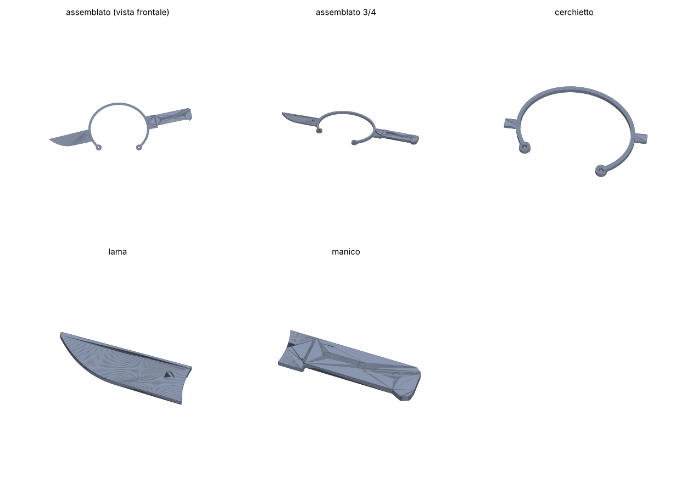

# Cerchietto "coltello in testa" per cane (PETG)

Tre pezzi, tutti stampati in piano senza supporti:

| File | Ingombro (mm) | Note |
|---|---|---|
| `cerchietto.stl` | 142 × 94 × 6 | archetto con 2 linguette di innesto e 2 occhielli per il sottogola |
| `lama.stl` | 81 × 25 × 4.5 | mezza lama, punta arrotondata |
| `manico.stl` | 90 × 26 × 6.5 | tallone della lama + manico, 3 rivetti incassati |
| `assemblato_anteprima.stl` | — | solo per vedere il risultato, **non stampare** |



## Misure

- Larghezza interna archetto: ~112 mm, altezza interna ~96 mm (taglia media, es. beagle / border collie).
- Coltello completo da punta a pomolo: ~280 mm.
- Peso totale stimato: ~20 g con infill 20%.

Per altre taglie cambia `A_ELLISSE` / `B_ELLISSE` in `genera.py` (misura la testa tra le basi delle orecchie
e aggiungi ~10 mm) e rigenera:

```
pip install manifold3d trimesh numpy
python3 genera.py
```

## Stampa (PETG)

- Ugello 0.4, layer 0.2 mm, 3 perimetri, infill 20% (cerchietto: 100% o 5 perimetri, così flette senza rompersi).
- Nessun supporto. Tutti i pezzi vanno sul piatto con la faccia più grande in giù (come esportati).
- 230–240 °C ugello, 75–85 °C piatto, ventola 30–50%.
- Colori: lama grigio/argento, manico e cerchietto neri. Il "sangue" a pennarello o acrilico rosso.

## Montaggio

1. Le linguette del cerchietto entrano nelle tasche sul retro di lama e manico (gioco 0.2 mm per lato).
   Le facce posteriori restano a filo.
2. Una goccia di colla CA (cianoacrilica) o epossidica nelle tasche per fissarle.
3. Passa un elastico tondo da 2–3 mm negli occhielli e annodalo sotto il mento del cane, lasco quanto basta
   per far passare due dita.

Non lasciare il cane incustodito con il cerchietto e non farglielo masticare.
