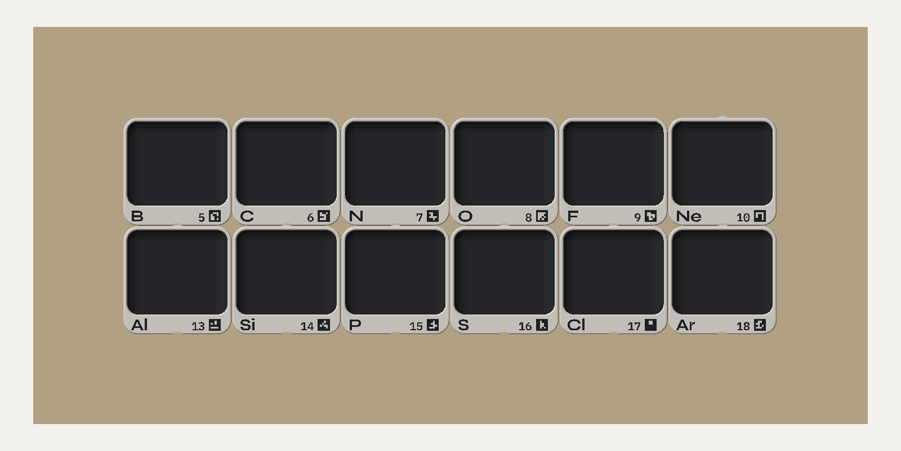

# Tavola periodica a cubi espositivi

Progetto parametrico (OpenSCAD) per stampare in 3D una tavola periodica fatta di
**cubi-vetrina staccabili** da 6 cm. Ogni cubo ha gli spigoli raggiati e dentro
una **nicchia curva**, come un'alcova, su cui appoggiare l'oggetto. Sul fronte ci
sono solo **simbolo, numero atomico e un piccolo marker** che un'app potrà
riconoscere con la fotocamera. Si fissa al pannello con **una sola vite**, coperta
da un tappino. Per cambiare elemento si cambia solo il numero atomico.


| Cubo singolo | Periodi 6-7 con segnaposto | Blocco f |
|---|---|---|
|  |  |  |

## Design

- **Forma**: un cubo di 60 mm con gli spigoli raggiati a 8 mm. Dove si incontrano
  quattro cubi resta una piccola fuga a rombo, come tra piastrelle a spigolo tondo.
  Il bordo del fronte è arrotondato, quindi tra due cubi accostati si vede una
  fuga d'ombra regolare.
- **Nicchia**: concentrica al profilo esterno e senza spigoli. Il fondo del cubo è
  il piano espositivo: dietro raccorda in curva verso schiena, pareti e tetto, e
  davanti sale con una curva fino alla fascia con la scritta. L'interno misura circa
  57 × 56 × 56 mm, la parte piatta del piano circa 44 × 29 mm e l'apertura 55 × 47 mm.
- **Tipografia**: le font di museo.chicubo.it. Una sola riga sulla stessa linea di
  base: a sinistra il simbolo in **Syne Bold** (6 mm), a destra il numero in **IBM
  Plex Mono SemiBold** (4,5 mm) e il marker. Sui due segnaposto il numero non
  c'è: "57–71" accanto a "La–Lu" non ci starebbe a una dimensione stampabile, e
  l'intervallo è già nel simbolo.

  
- **Colori**: corpo e nicchia scuri, lastra frontale chiara, scritte e marker scuri.
  Si ottiene con due cambi filamento in altezza, senza pezzi separati.

## Riconoscimento con la fotocamera (per la futura app)

Ogni cubo ha sulla fascia un **marker ArUco** del dizionario `DICT_4X4_250`
(6 × 6 celle da 1,1 mm, cioè 6,6 mm di lato). Il suo **ID è il numero atomico**;
i due segnaposto hanno 119 (La–Lu) e 120 (Ac–Lr). È in rilievo e si stampa con lo
stesso cambio colore delle scritte.

Perché un marker e non solo il testo: il numero in Plex Mono si potrebbe leggere
anche con l'OCR, ma è fragile (luce radente, angolo, la grafia particolare di
Syne). Il marker invece:
- si rileva in modo robusto e veloce, nel browser (OpenCV.js, js-aruco2) o in
  un'app;
- funziona anche con molti cubi nella stessa inquadratura;
- dà anche la posizione e l'orientamento del cubo, utili per sovrapporre contenuti
  in realtà aumentata.

**Verificato sui render** con OpenCV:
- con ~4,4 pixel per millimetro (il marker largo ~29 pixel) riconosce tutti i
  marker con l'ID giusto, sia frontalmente sia con i cubi inclinati di 15–25°;
- con ~2,2 pixel per millimetro (la tavola intera in un'immagine da 2600 pixel) non
  ne riconosce nessuno.

In pratica: inquadrare un cubo o un gruppo di cubi funziona. La tavola intera da
lontano, con un telefono da 12 MP (~3,6 px/mm), è al limite. Prima di stampare
tutto conviene provarlo su un cubo vero, con il telefono. Se serve un marker più
grande c'è il parametro `codice_cella`.

## File

| Percorso | Cosa contiene |
|---|---|
| `cubo_elemento.scad` | il modello: tutti i parametri sono in cima al file |
| `elementi.scad` | tabella dei 118 elementi e dei marker (generata, non modificarla a mano) |
| `font/` | Syne e IBM Plex (licenza OFL), caricate direttamente dal modello |
| `dati/elementi.csv` | **dati di partenza**: nomi italiani, masse e categorie (utili all'app; sul cubo vanno solo simbolo e numero) |
| `strumenti/tavola.py` | genera la tabella, calcola i vicini, esporta gli STL, fa lo schema del pannello |
| `stl/` | **solo campioni**: H, He, Fe, Au, Rf, un segnaposto, più `comune_tappo.stl` e `comune_dima.stl` |
| `anteprime/` | render per presentazioni |
| `dati/pannello.svg`, `dati/fori_pannello.csv` | schema e quote di foratura del pannello |
| `strumenti/render_tavola.py`, `strumenti/anteprima.py` | i render (`USA_STL=1 … 1 10 1 18` per la tavola completa, dopo `esporta tutti`) |

## Uso

**Da OpenSCAD** (per un cubo alla volta): apri `cubo_elemento.scad`, nel Customizer
imposta `Z` e `parte = corpo`, poi F6 ed esporta l'STL. Per un testo libero metti
`Z = 0`, compila `simbolo_testo` e `numero_testo` e scegli un `codice_id`.

**Dallo script** (consigliato, perché imposta da solo incastri e finestre in base ai
vicini):

```bash
python3 strumenti/tavola.py esporta           # solo i campioni
python3 strumenti/tavola.py esporta tutti     # tutti i 120 cubi (non vanno nel repository)
python3 strumenti/tavola.py esporta 26 Fe 79  # solo alcuni
python3 strumenti/tavola.py elenco            # posizioni e incastri di ogni cubo
python3 strumenti/tavola.py pannello          # rigenera pannello.svg e fori_pannello.csv
python3 strumenti/tavola.py genera            # dopo aver modificato dati/elementi.csv (serve opencv-python)
```

Serve OpenSCAD (testato con la 2021.01). Le font sono nella cartella `font/` e il
modello le carica da lì, quindi non vanno installate.
`trimesh` (`pip install trimesh`) è facoltativo: serve solo a salvare gli STL in binario.

## Com'è fatto

 

*Sezione laterale (il fronte è a destra) e retro.*

- **Fondo**: un solo fondo da 2,4 mm, che è anche il piano espositivo. Davanti sale
  in curva fino alla fascia. Sotto la curva resta un piccolo cuneo, svuotato con un
  guscio da 1,2 mm.
- **Finestre**: le pareti che confinano con un altro cubo hanno una finestra, che da
  fuori resta coperta dal vicino. Su ogni confine se ne apre una sola (fianco destro
  e tetto), così tra due nicchie resta sempre una parete piena e un oggetto non si
  vede dal cubo accanto. Sui cubi del perimetro le pareti esterne restano piene;
  lo script decide da solo. Da dentro la nicchia la finestra si vede come un
  pannello incassato, dello stesso colore scuro.
- **Fissaggio**: **una vite M3 a testa svasata** al centro della schiena, su un
  mozzo. Sopra la testa c'è la sede per un **tappino** a filo dello stesso colore
  del corpo (`comune_tappo.stl`), con una tacca per sollevarlo con la punta di un
  cacciavite. Nello stesso mozzo, accanto alla vite, c'è un foro cieco dal retro
  per una **spina Ø4** fissata nel pannello, che impedisce al cubo di ruotare.
- **Incastro tra cubi sovrapposti**: una linguetta a coda di rondine (45°) sopra
  entra nella scanalatura del fondo del cubo superiore. Corre dal fronte al retro,
  quindi **ogni cubo si sfila in avanti da solo**. Lo script la mette solo dove c'è
  un cubo sopra o sotto.

## Stampa (Creality K2)

**Nessun supporto.** Il cubo è già orientato sdraiato, con il retro sul piatto e la
scritta in alto. In questa posizione:
- le curve della nicchia stanno sul piano di stampa, scendono "a ciotola" verso il
  piatto oppure, davanti, non superano i 45°;
- lo svaso della vite si allarga verso l'alto;
- le finestre sono semplici buchi in pareti verticali;
- l'unico ponte è il tetto del cuneo vuoto, di 6,4 mm.

Impostazioni consigliate: ugello 0,4, layer 0,2 mm, 3 perimetri, riempimento 15%,
PLA opaco (riduce i riflessi anche per la fotocamera). Le pareti da 1,2 mm sono
esattamente 3 linee.

**Colori con il CFS**: due cambi filamento in altezza, uguali per tutti i cubi del
piatto.

| Da quota (mm) | Cosa si stampa | Filamento |
|---|---|---|
| 0 | corpo e nicchia | scuro (nero o grafite opaco) |
| **58,0** | lastra frontale | chiaro |
| **60,0** | simbolo, numero e marker in rilievo | scuro |

Il marker ha bisogno di contrasto: scuro su chiaro, come sopra. Il tappino si stampa
piatto, nel colore del corpo.

**Quanti per piatto**: un cubo occupa 60 × 61 mm (linguetta compresa). Sulla **K2
Plus** (350 × 350) ne stanno **25** (5 × 5), su un piatto da 300 mm ne stanno 16.

**Materiale**: un cubo con tutti i vicini è circa **28 cm³ (~35 g di PLA)**.
Per tutta la tavola (120 cubi, che non hanno tutti le stesse finestre) servono
**3400 cm³, circa 4,2 kg**.

## Montaggio

**Pannello**: multistrato da 18 mm, **1089 × 605 mm** (18 × 10 caselle, passo
60,5 mm, con una riga vuota prima del blocco f). In `dati/fori_pannello.csv` ci
sono le quote di ogni foro, misurate dal basso a sinistra guardando il pannello di
fronte. `dati/pannello.svg` è lo schema in scala 1:1.
`comune_dima.stl` è una dima leggera da appoggiare su ogni casella, con le boccole
guida per vite e spina.

Per **ogni cubo** servono:

- 1 vite **M3×12 a testa svasata piana** (ISO 10642, esagono incassato), su un
  **inserto filettato M3 per legno** nel pannello. Così il cubo si toglie e si
  rimette quante volte vuoi. La vite attraversa 5,1 mm di plastica.
- 1 spina Ø4 (tondino d'acciaio o di legno), incollata nel pannello e sporgente di
  3 mm.

**Ordine**: fissa le spine, poi appoggia il cubo spingendolo dritto verso il
pannello lungo la linguetta. Avvita la vite dal fronte, metti il tappino e appoggia
l'oggetto.

## Parametri principali (`cubo_elemento.scad`)

| Parametro | Default | Note |
|---|---|---|
| `lato`, `profondita` | 60 | dimensioni esterne |
| `raggio`, `raggio_fondo` | 8 / 8 | spigoli esterni e curva della nicchia verso la schiena |
| `parete`, `fondo`, `schiena` | 1,2 / 2,4 / 1,6 | spessori |
| `fascia_h`, `labbro` | 10 / 1 | fascia con i testi; quanto la cornice sporge dentro la nicchia |
| `h_simbolo`, `h_numero` | 6 / 4,5 | altezza delle maiuscole in mm (sotto 3 il tratto diventa troppo sottile per un ugello da 0,4); il numero si riduce da solo se non ci sta |
| `codice`, `codice_cella` | true / 1,1 | marker ArUco e lato di una cella |
| `finestre` | true | finestre sui confini con altri cubi (`finestra_sopra` e `finestra_dx` li imposta lo script) |
| `mostra_numero`, `mostra_nome` | true / false | con il nome il numero sale sopra di lui, allineato alla cima del simbolo |
| `font_simbolo`, `font_numero`, `font_nome` | Syne Bold / Plex Mono SemiBold | |
| `testo_modo`, `testo_h` | rilievo / 0,6 | oppure `inciso` |
| `vite_d`, `svasatura_d` | 3,4 / 6,9 | M3; per M4: 4,5 / 9,2 |
| `lingua_sopra`, `scanalatura_sotto` | true | li imposta lo script in base ai vicini |

Se cambi le dimensioni, rilancia `esporta` e `pannello`. Lo schema del pannello e i
render leggono le quote direttamente dal modello.
