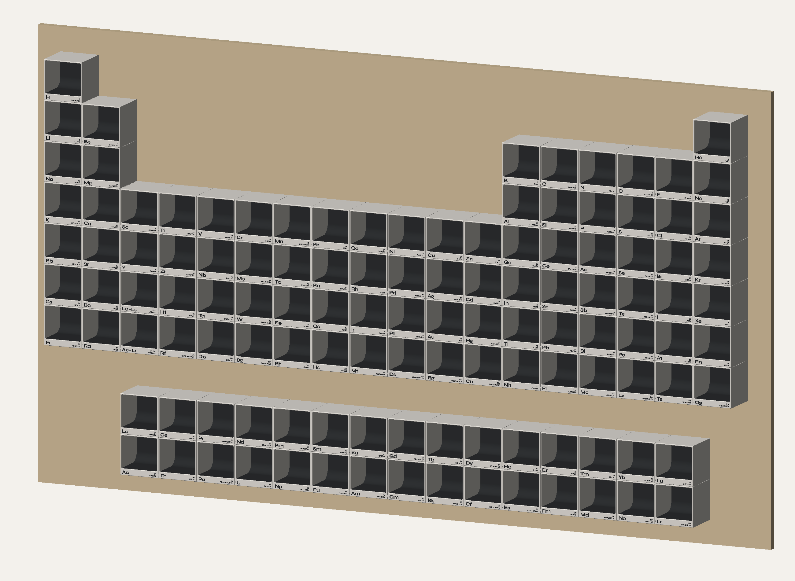
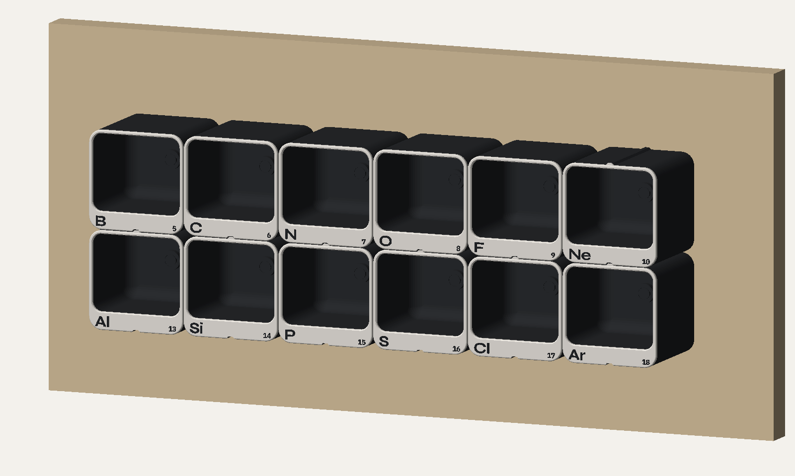
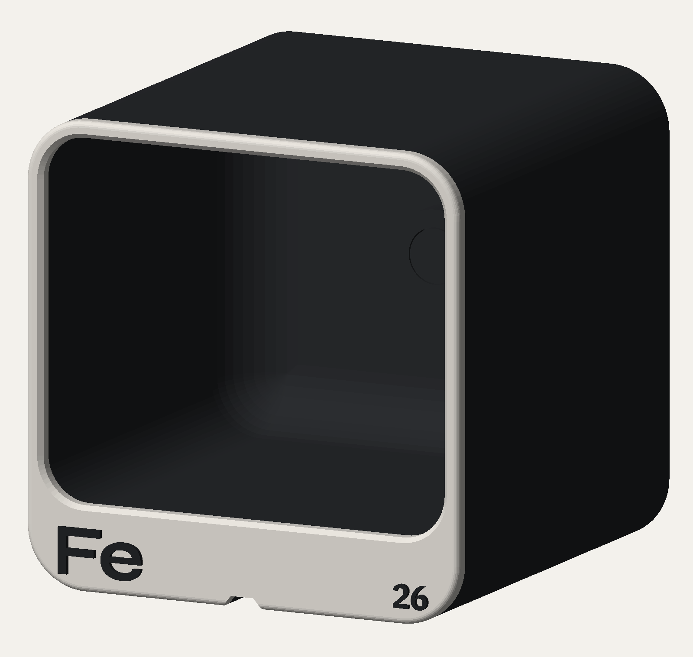
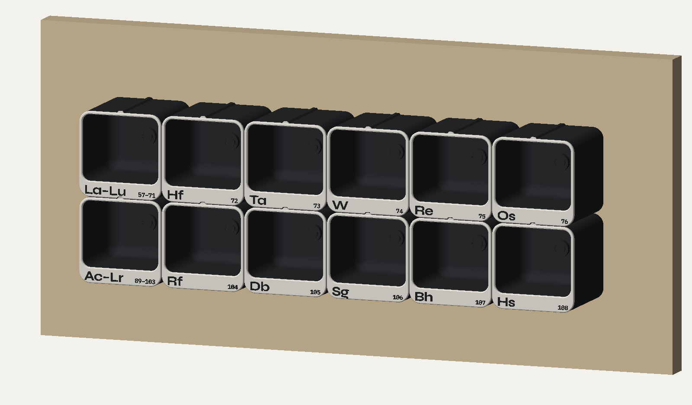
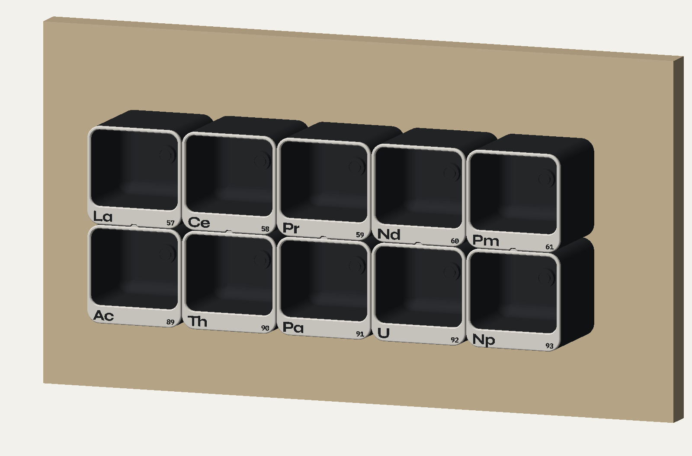
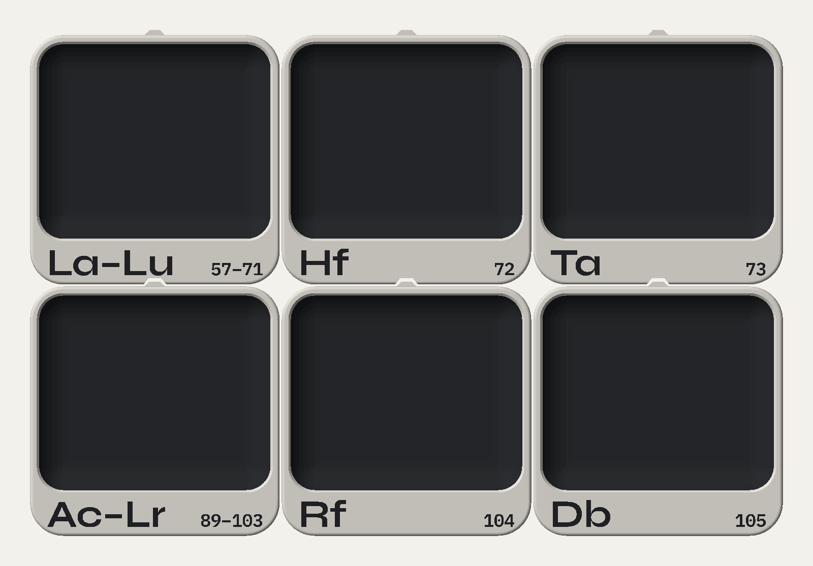
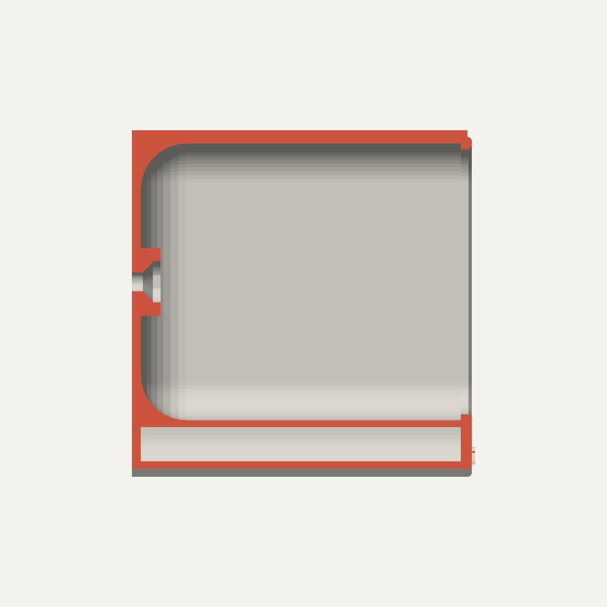
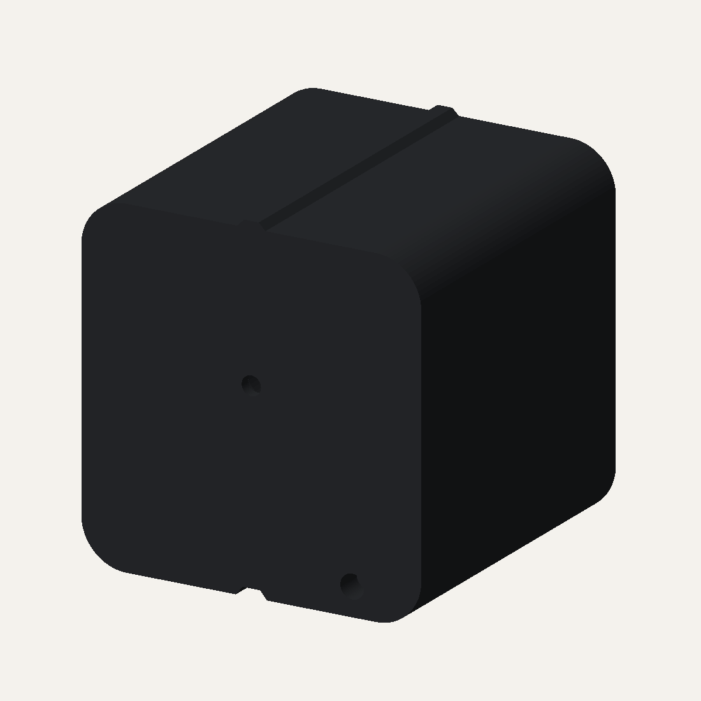

# Tavola periodica a cubi espositivi

Progetto parametrico (OpenSCAD) per stampare in 3D una tavola periodica fatta di
**cubi-vetrina staccabili** da 6 cm. Ogni cubo ha gli spigoli raggiati e dentro
una **nicchia curva**, come un'alcova, su cui appoggiare l'oggetto. Sul fronte ci
sono solo **simbolo e numero atomico**: il resto lo racconterà l'app. Si fissa al
pannello con **una sola vite**, coperta da un tappino. Per cambiare elemento si
cambia solo il numero atomico.





| Cubo singolo | Periodi 6-7 con segnaposto | Blocco f |
|---|---|---|
|  |  |  |

## Design

- **Forma**: un cubo di 60 mm con gli spigoli raggiati a 8 mm. Dove si incontrano
  quattro cubi resta una piccola fuga a rombo, come tra piastrelle a spigolo tondo.
  Il bordo del fronte è arrotondato, quindi tra due cubi accostati si vede una
  fuga d'ombra regolare.
- **Nicchia**: concentrica al profilo esterno e raccordata in curva verso il fondo
  su tutti e quattro i lati, senza spigoli. Il piano è a filo della fascia, così la
  fascia non copre la base dell'oggetto. Lo spazio utile è di circa 57 × 49 mm
  (apertura 55 × 47) e 56 mm di profondità.
- **Tipografia**: le font di museo.chicubo.it. Una sola riga sulla stessa linea di
  base: a sinistra il simbolo in **Syne Bold** (6 mm), a destra il numero in **IBM
  Plex Mono SemiBold** (3 mm).

  
- **Colori**: corpo e nicchia scuri, lastra frontale chiara, scritte scure. Si
  ottiene con due cambi filamento in altezza, senza pezzi separati.

## File

| Percorso | Cosa contiene |
|---|---|
| `cubo_elemento.scad` | il modello: tutti i parametri sono in cima al file |
| `elementi.scad` | tabella dei 118 elementi (generata, non modificarla a mano) |
| `font/` | Syne e IBM Plex (licenza OFL), caricate direttamente dal modello |
| `dati/elementi.csv` | **dati di partenza**: nomi italiani, masse e categorie (utili all'app; sul cubo vanno solo simbolo e numero) |
| `strumenti/tavola.py` | genera la tabella, calcola i vicini, esporta tutti gli STL, fa lo schema del pannello |
| `stl/` | 118 elementi + 2 segnaposto già orientati per la stampa, più `comune_tappo.stl` e `comune_dima.stl` |
| `dati/pannello.svg`, `dati/fori_pannello.csv` | schema e quote di foratura del pannello |
| `strumenti/render_tavola.py`, `strumenti/anteprima.py` | le immagini di questa pagina (`USA_STL=1 … 1 10 1 18` per la tavola completa) |

## Uso

**Da OpenSCAD** (per un cubo alla volta): apri `cubo_elemento.scad`, nel Customizer
imposta `Z` e `parte = corpo`, poi F6 ed esporta l'STL. Per un testo libero metti
`Z = 0` e compila `simbolo_testo` e `numero_testo`.

**Tutti insieme** (consigliato, perché imposta da solo gli incastri in base ai vicini):

```bash
python3 strumenti/tavola.py genera            # solo se hai modificato dati/elementi.csv
python3 strumenti/tavola.py esporta           # tutti i cubi in stl/
python3 strumenti/tavola.py esporta 26 Fe 79  # solo alcuni
python3 strumenti/tavola.py elenco            # posizioni e incastri di ogni cubo
python3 strumenti/tavola.py pannello          # rigenera pannello.svg e fori_pannello.csv
```

Serve OpenSCAD (testato con la 2021.01). Le font sono nella cartella `font/` e il
modello le carica da lì, quindi non vanno installate.
`trimesh` (`pip install trimesh`) è facoltativo: serve solo a salvare gli STL in binario.

## Com'è fatto

 

*Sezione laterale (il fronte è a destra) e retro.*

- **Fissaggio**: **una vite M3 a testa svasata** al centro della schiena, su un
  mozzo. Sopra la testa c'è la sede per un **tappino** a filo dello stesso colore
  del corpo (`comune_tappo.stl`), con una tacca per sollevarlo con la punta di un
  cacciavite. In basso a sinistra, sotto il piano, c'è un foro cieco per una
  **spina Ø4** fissata nel pannello, che impedisce al cubo di ruotare.
- **Vano sotto il piano**: lo spazio tra il piano della nicchia e il fondo è vuoto
  e chiuso. Alleggerisce il pezzo e contiene il rinforzo della scanalatura e il
  mozzo della spina.
- **Incastro tra cubi sovrapposti**: una linguetta a coda di rondine (45°) sopra
  entra nella scanalatura sotto il cubo superiore. Corre dal fronte al retro,
  quindi **ogni cubo si sfila in avanti da solo**. Lo script la mette solo dove c'è
  un cubo sopra o sotto, così il perimetro della tavola resta pulito.

## Stampa (Creality K2)

**Nessun supporto.** Il cubo è già orientato sdraiato, con il retro sul piatto e la
scritta in alto. In questa posizione:
- le curve della nicchia stanno sul piano di stampa, oppure scendono "a ciotola"
  verso il piatto;
- lo svaso della vite si allarga verso l'alto;
- l'unico ponte è il tetto del vano, di 7,6 mm.

Impostazioni consigliate: ugello 0,4, layer 0,2 mm, 3 perimetri, riempimento 15%,
PLA opaco. Le pareti da 1,2 mm sono esattamente 3 linee.

**Colori con il CFS**: due cambi filamento in altezza, uguali per tutti i cubi del
piatto.

| Da quota (mm) | Cosa si stampa | Filamento |
|---|---|---|
| 0 | corpo e nicchia | scuro (nero o grafite opaco) |
| **58,0** | lastra frontale | chiaro |
| **60,0** | simbolo e numero in rilievo | scuro |

Per un cubo tutto chiaro con le scritte scure basta il cambio a 60,0. Il tappino si
stampa piatto, nel colore del corpo. `parte = testo` esporta solo le scritte, già
allineate, se preferisci assegnarle come parte separata.

**Quanti per piatto**: un cubo occupa 60 × 61,2 mm (linguetta compresa). Sulla
**K2 Plus** (350 × 350) ne stanno **25** (5 × 5), su un piatto da 300 mm ne
stanno 16.

**Materiale**: circa **31 cm³ per cubo (~39 g di PLA)**, cioè **~4,7 kg per tutta
la tavola** (120 cubi). È circa un quarto della versione da 10 cm.

## Montaggio

**Pannello**: multistrato da 18 mm, **1089 × 605 mm** (18 × 10 caselle, passo
60,5 mm, con una riga vuota prima del blocco f). In `dati/fori_pannello.csv` ci
sono le quote di ogni foro, misurate dal basso a sinistra guardando il pannello di
fronte. `dati/pannello.svg` è lo schema in scala 1:1.
`comune_dima.stl` è una dima leggera da appoggiare su ogni casella, con le boccole
guida per vite e spina.

Per **ogni cubo** servono:

- 1 vite **M3×12 a testa svasata piana** (ISO 10642, esagono incassato), su un
  **inserto filettato M3 per legno** nel pannello. Così il cubo si toglie e si
  rimette quante volte vuoi. La vite attraversa 5,1 mm di plastica.
- 1 spina Ø4 (tondino d'acciaio o di legno), incollata nel pannello e sporgente di
  4 mm.

**Ordine**: fissa le spine, poi appoggia il cubo spingendolo dritto verso il
pannello lungo la linguetta. Avvita la vite dal fronte, metti il tappino e appoggia
l'oggetto.

## Parametri principali (`cubo_elemento.scad`)

| Parametro | Default | Note |
|---|---|---|
| `lato`, `profondita` | 60 | dimensioni esterne |
| `raggio`, `raggio_fondo` | 8 / 8 | spigoli esterni e curva della nicchia verso il fondo |
| `parete`, `schiena` | 1,2 / 1,6 | spessori |
| `fascia_h`, `labbro` | 10 / 1 | fascia con i testi; quanto la cornice sporge dentro la nicchia |
| `h_simbolo`, `h_numero` | 6 / 3 | altezza delle maiuscole in mm (sotto 3 il tratto diventa troppo sottile per un ugello da 0,4) |
| `mostra_numero`, `mostra_nome` | true / false | con il nome il numero sale sopra di lui, allineato alla cima del simbolo |
| `font_simbolo`, `font_numero`, `font_nome` | Syne Bold / Plex Mono SemiBold | |
| `numero_cifre` | 0 | 3 per numeri da catalogo (026) |
| `testo_modo`, `testo_h` | rilievo / 0,6 | oppure `inciso` |
| `vite_d`, `svasatura_d` | 3,4 / 6,9 | M3; per M4: 4,5 / 9,2 |
| `lingua_sopra`, `scanalatura_sotto` | true | li imposta lo script in base ai vicini |

Se cambi le dimensioni, rilancia `esporta` e `pannello`. Lo schema del pannello e i
render leggono le quote direttamente dal modello.
