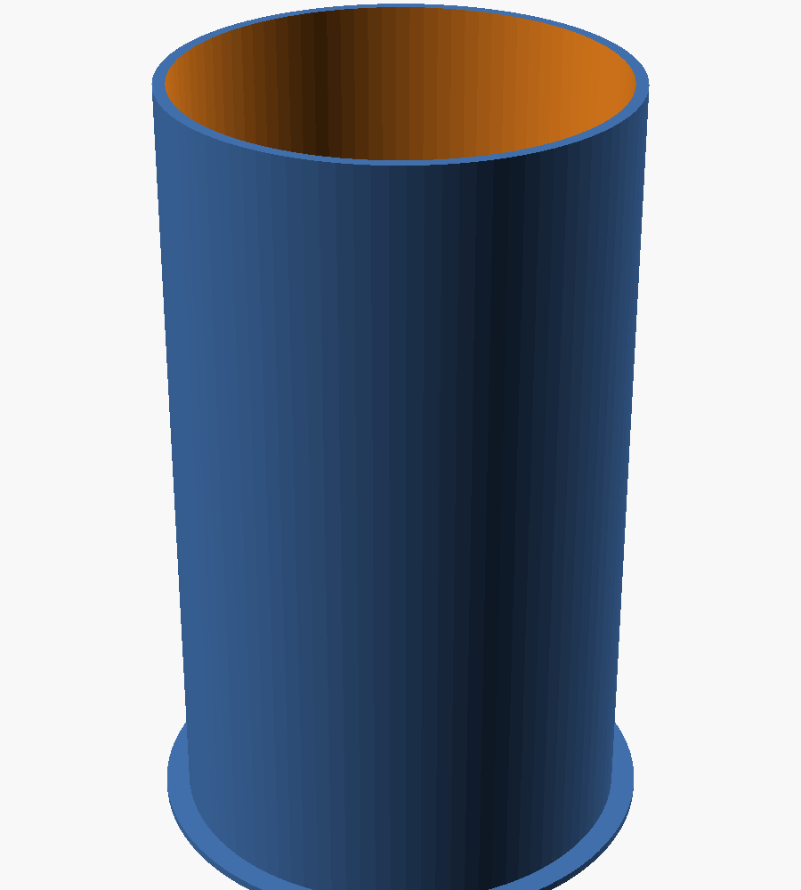

# Case cilindrico schermato per raggi X da 2X2A in sovratensione

Progetto parametrico (OpenSCAD) di un contenitore **a tubo** stampabile in 3D per un tubo
raddrizzatore **2X2A** usato come sorgente di raggi X. È dimensionato per una **Creality K2 Pro**
(piano 300 × 300 × 300 mm) e fatto per **usare poco piombo**.

- schermatura in **fogli di piombo da 1 mm avvolti** attorno a un bicchiere stampato,
  default **3 fogli = 3 mm** (`lead_n = 2` per 2 mm), con giunti sfalsati;
- fondo e coperchio con dischi da 1 mm;
- **camini piombati fuori asse** per il cavo AT (coperchio) e i cavi BT (fondo):
  nessuna linea retta dal tubo esce dai fori, e il file `.scad` lo verifica da solo;
- **finestra** con membrana stampata, filtro Al e otturatore piombato;
- **basamento con connettori** (filamento/catodo, interblocco, terra, riserva) e **interblocco** sul coperchio.


| Fronte | Retro | Bicchiere interno |
|---|---|---|
|  |  |  |

| Basamento | Passante AT | Modulo finestra |
|---|---|---|
|  |  |  |

---

## 1. Perché a tubo: quanto piombo serve

Il tubo emette in tutte le direzioni (vedi §2), quindi lo schermo deve chiudere tutto attorno.
Con un cilindro coassiale ogni millimetro di distanza dall'AT costa molto meno superficie che con un box.
La distanza conta per l'isolamento, perché il piombo è collegato a terra.

| Versione | Ingombro corpo | Piombo |
|---|---|---|
| box precedente, 3 mm | 155 × 155 × 211 | ~5,8 kg |
| **tubo, 3 mm** (default) | Ø126 × 196 | **~3,3 kg** (0,29 m² di foglio) |
| tubo, 2 mm (`lead_n=2`) | Ø124 × 195 | ~2,2 kg |
| tubo compatto, 3 mm (`hv_clear=30`, `top_clear=35`) | Ø116 × 191 | ~2,9 kg |
| tubo compatto, 2 mm | Ø114 × 190 | ~1,9 kg |

**2 mm o 3 mm?** Trasmissione attraverso il piombo (NIST XCOM):

| Energia | 2 mm | 3 mm |
|---|---|---|
| 50 keV | 1·10⁻⁸ | 1·10⁻¹² |
| 60 keV | 1·10⁻⁵ | 4·10⁻⁸ |
| 80 keV | 4·10⁻³ | 3·10⁻⁴ |
| 88 keV | 1·10⁻² | 1,5·10⁻³ |

Se il tuo alimentatore resta sotto circa **60 kV, bastano 2 mm** e risparmi 1,1 kg di piombo.
3 mm servono se può salire verso 80–90 kV.

**Distanze di isolamento.** Di default ci sono **35 mm d'aria tra il vetro e la parete**. La placca sta
circa 10 mm più dentro il vetro, quindi tra placca e piombo ci sono ~48 mm: 3 mm di PETG pieno più l'aria.
Sopra il cappuccio anodico ci sono 40 mm. Con la versione compatta (30/35 mm) resti attorno a 1 mm/kV
fino a ~45 kV; oltre, tieni i valori di default.

## 2. Cosa dice la ricerca online

**Il tubo.** Il 2X2A è un raddrizzatore EHT a semionda, a vuoto spinto: 12,5 kV PIV a 7,5 mA, filamento
2,5 V / 1,75 A, zoccolo UX4 con cappuccio superiore (anodo). L'ampolla misura circa 36 × 97 mm.
Equivalenti: 2X2, 2B21, 879, CV597.

**Chi lo usa per i raggi X.** È un classico esperimento hobbistico:

- Lo si alimenta con un flyback + moltiplicatore a circa **50 kV**. Il tubo inizia a condurre verso **40 kV**.
- Altri usano macchine elettrostatiche (Wimshurst, Van de Graaff).
- La resa cambia molto da un esemplare all'altro: United Nuclear li selezionava.
- Un costruttore misura circa **800 µSv/h a 15 cm**.

**Da dove escono i raggi X.** Gli elettroni del catodo colpiscono la **placca**. La maggior parte
dell'emissione esce **attorno al bordo inferiore della "campana" anodica**, come un **anello diffuso**
perpendicolare all'asse del tubo. Non c'è un fascio, e le immagini migliori si ottengono con il tubo
inclinato di circa 45°. Per questo la finestra sta all'altezza del bordo della placca (`anode_rim_h`)
e lo schermo chiude tutte le direzioni.

## 3. Come è fatto

1. **Bicchiere interno** (`cup`): parete di 3 mm in PETG **pieno al 100%**, che fa da isolante tra AT e piombo.
   Ha fondo, flangia alla base e la **membrana della finestra** da 0,8 mm.
   Sulla flangia ci sono **tacche** che indicano dove cade il giunto di ciascuno strato.
2. **Piombo di parete**: le strisce da 1 mm si avvolgono una alla volta **attorno al bicchiere**.
   Si allinea il foro con la finestra e il giunto cade da solo sulla tacca; i giunti sono sfalsati di 40°.
   Il piombo parte dalla flangia, 2 mm **sotto** il piombo del fondo, quindi non c'è una linea retta
   che passi tra parete e fondo.
3. **Manicotto esterno** (`sleeve`): si infila sopra il piombo avvolto e porta:
   - le borchie del modulo finestra;
   - il blocchetto del microswitch;
   - la chiavetta che orienta il coperchio.
4. **Fondo e coperchio**: 3 dischi ciascuno. Quelli del coperchio coprono anche il bordo
   del bicchiere, del piombo e del manicotto.
5. **Camini piombati** con tasca anulare per 3 strisce avvolte:
   - **AT** (`hv_bushing`) sul coperchio, a 40 mm dall'asse. Ha alette a 45° (allungano il percorso
     superficiale) e un serracavo a vite.
   - **BT** (`lv_chimney`) sotto il fondo, dentro il basamento.

   Lo `.scad` calcola la lunghezza minima che blocca ogni raggio rettilineo dalla placca al foro
   (31 e 27 mm) e si ferma con un errore se il camino è più corto di 1,3 volte quel valore.
   Di default sono lunghi 50 e 40 mm.
6. **Basamento** (`plinth`): è una vaschetta cilindrica che il corpo chiude, con un retro piatto
   per i connettori in 2 × 2:

| Etichetta | Connettore | Uso |
|---|---|---|
| FIL/K | GX16-4 | filamento 2,5 V + catodo |
| INTLK | GX12-2 | contatto del microswitch, in serie all'abilitazione del driver AT |
| GND | morsetto 4 mm / prigioniero | terra: tutto il piombo + ritorno catodo |
| AUX | GX12-3 | riserva (sensore T, LED "AT ON", contatore) |

   Dietro i connettori la parete è assottigliata a 3 mm per poter avvitare le ghiere.
   Sui fianchi ci sono feritoie (zona BT, fuori dallo schermo).
7. **Interblocco**: un dito sulla gonna del coperchio preme un microswitch KW11 sul retro del manicotto.
   La chiavetta impedisce di chiudere il coperchio ruotato.

## 4. File e parametri

```
xray_case_2x2a.scad      sorgente parametrico
build.sh                 rigenera stl/, lead_templates/, render/
stl/                     cup, sleeve, lid, plinth, tray, lv_chimney, hv_bushing, window_frame, shutter
lead_templates/          sagome 1:1 .svg/.dxf per tagliare il piombo
tools/section_svg.py     disegno della sezione
```

**Prima di stampare** misura il tuo tubo e correggi `anode_rim_h` (altezza del bordo inferiore della
placca sopra lo zoccolo), `tube_seated_h` e `socket_mount`. Scegli anche lo spessore con `lead_n`
e le distanze con `hv_clear`/`top_clear`, poi lancia `./build.sh`. L'output riporta le misure di
ogni striscia e il peso del piombo, e controlla camini e ingombro.

### Fogli da 1 mm (default, 3 strati)

| Sagoma | Q.tà | Misure (mm) | Note |
|---|---|---|---|
| `wall_L1` | 1 | 362,4 × 194 | foro finestra a 181,4 mm dall'estremità sinistra |
| `wall_L2` | 1 | 368,6 × 194 | foro a 143,6 mm |
| `wall_L3` | 1 | 374,9 × 194 | foro a 229,4 mm |
| `floor` | 3 | disco Ø107,5 | foro Ø8 per i cavi BT |
| `lid` | 3 | disco Ø126 | foro Ø8 per il cavo AT |
| `chimney_hv` | 1 serie | 37,4 / 43,7 / 50,0 × 50 | 3 strisce, una per strato |
| `chimney_lv` | 1 serie | 37,4 / 43,7 / 50,0 × 40 | |
| `shutter` | 3 | 30 × 30 | otturatore |

Se il tuo foglio è più corto di 375 mm, una striscia si può fare in **due pezzi**. Metti la seconda
giunzione lontana sia dalla finestra sia dai giunti degli altri strati (almeno 30 mm).

## 5. Distinta componenti

- PETG o ASA: circa 0,9 kg. Il bicchiere va stampato al 100% di riempimento. Non usare PLA.
- Zoccolo UX4 ceramico + 2 viti M3.
- GX16-4 da pannello + spina; GX12-2 e GX12-3 da pannello + spine; morsetto 4 mm.
- Microswitch KW11-3Z + 2 viti M2 autofilettanti.
- Viti M3 autofilettanti: 4 per la finestra, 3 per il passante AT, 3 per il camino BT; 2 × M3 + dado per il serracavo.
- Cavo AT siliconico **≥ 40 kV DC** (Ø 4–7 mm) con clip per il cappuccio.
- Lamierino di alluminio da 0,5–1 mm (filtro 44 × 60), nastro di rame adesivo, nastro kapton.

## 6. Montaggio

1. **Stampa**: il bicchiere, il manicotto e il basamento vanno in piedi, senza supporti.
   Il coperchio e il supporto vanno capovolti (`build.sh` li orienta già). I camini si stampano con la
   flangia sul piatto; l'otturatore in piano.
2. **Piombo**: taglialo con le sagome (cutter e righello). Usa guanti, non carteggiare e lavati le mani.
3. **Terra**: salda o fissa con nastro di rame un filo sottile sull'estremità inferiore dello strato 1,
   e fallo uscire dal foro nella flangia e dalla canalina sotto di essa. Metti strisce di rame tra uno
   strato e l'altro, così tutti gli strati sono collegati.
4. **Avvolgi** gli strati L1, L2, L3 attorno al bicchiere, **tutti nello stesso verso**, con il foro sulla
   finestra; il giunto deve cadere sulla tacca. Fissa ogni strato con kapton e schiaccialo bene contro
   quello sotto (rullo o manico di cacciavite). Poi infila il manicotto dall'alto.
5. **Fondo**: posa i 3 dischi nel bicchiere con i fori allineati; uno dei fili BT porta la terra dei dischi.
   Avvolgi le strisce nel camino BT e avvitalo sotto il fondo.
6. **Zoccolo**: monta zoccolo e supporto e porta filamento e catodo al GX16 passando dal camino.
   **Verifica il pinout del 2X2A sul datasheet.**
7. **Coperchio**: incolla i 3 dischi sotto il coperchio con biadesivo. Metti una striscia di rame sul bordo
   superiore del piombo di parete, così i dischi del coperchio sono a terra quando è chiuso. Avvolgi le
   strisce nel passante AT, avvitalo e passa il cavo AT fino al cappuccio, lontano dalle pareti.
8. **Interblocco**: avvita il microswitch e regola con rondelle il punto di scatto. Porta i fili al GX12
   INTLK passando dalla tacca del basamento. Il driver AT deve accendersi solo con il coperchio chiuso.
9. **Finestra**: avvita il modulo, inserisci il filtro Al e lascia l'otturatore abbassato (chiuso).

## 7. Sicurezza: leggere prima di accendere

- **Misura con un rilevatore adatto ai raggi X molli** (Geiger a finestra sottile o camera a ionizzazione)
  tutto attorno, in particolare ai giunti, ai camini, al bordo del coperchio e attorno alla finestra.
  Parti da tensioni basse. Il progetto non sostituisce la misura.
- **Mai mani o occhi davanti alla finestra aperta.** Comanda l'apparato da lontano.
- **L'AT è letale** e i moltiplicatori restano carichi: scaricali con un'asta di scarica prima di aprire.
- **Ozono**: lavora in un ambiente ventilato. Fai cicli brevi, perché la cavità schermata è chiusa.
- In Italia gli apparecchi che generano radiazioni ionizzanti ricadono nel **D.Lgs. 101/2020**.
  Informati sugli obblighi prima dell'uso.

## Fonti

- [Radiomuseum – 2X2A](https://radiomuseum.org/tubes/tube_2x2a.html)
- [R-Type – 2X2A](https://r-type.org/exhib/aaa0506.htm)
- [Quantumnet – 2X2A X-ray tube](http://quantumnet.wikidot.com/2x2a)
- [Uzzors2k – Tube X-ray](http://uzzors2k.com/index.php?page=tubexray)
- [Civilpedia – X-Rays with the 2x2A](https://civilpedia.org/p/?pid=304)
- [Science Buddies – discussione 2X2A come sorgente X](https://www.sciencebuddies.org/science-fair-projects/ask-an-expert/viewtopic.php?p=47197)
- [Electrostatic Machines (UFRJ)](https://www.coe.ufrj.br/~acmq/electrostatic.html)
- NIST XCOM / X-Ray Mass Attenuation Coefficients (piombo)
