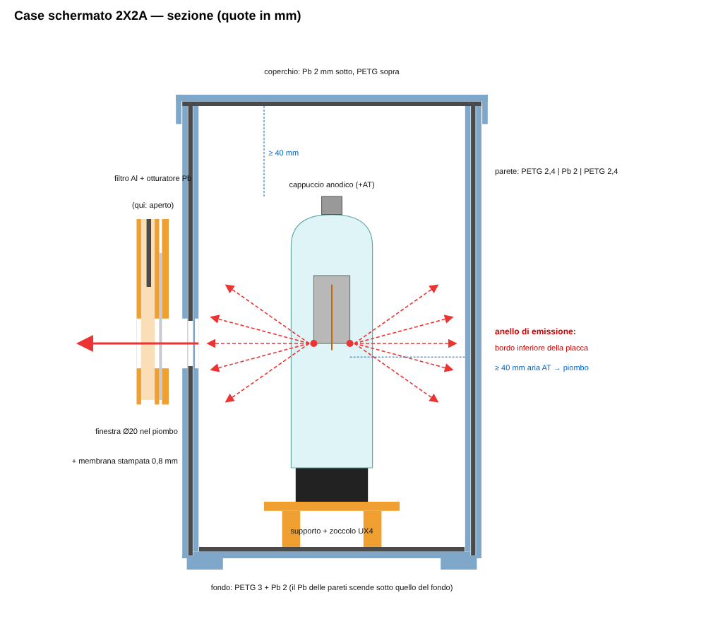
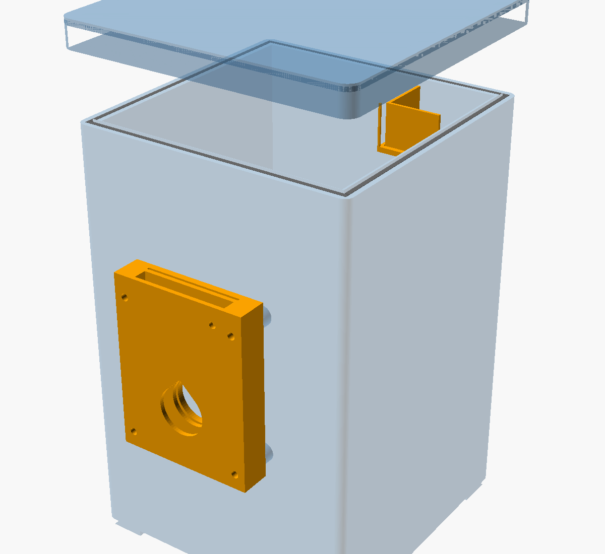
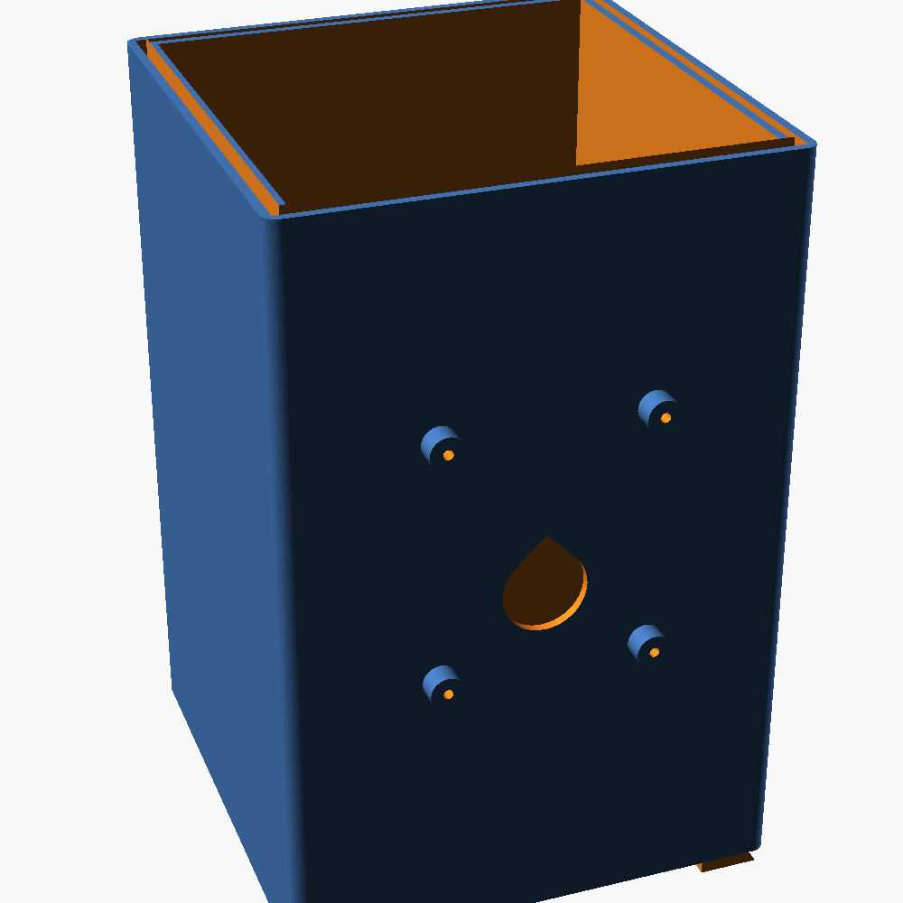
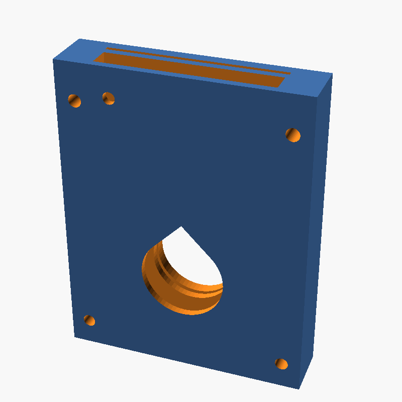
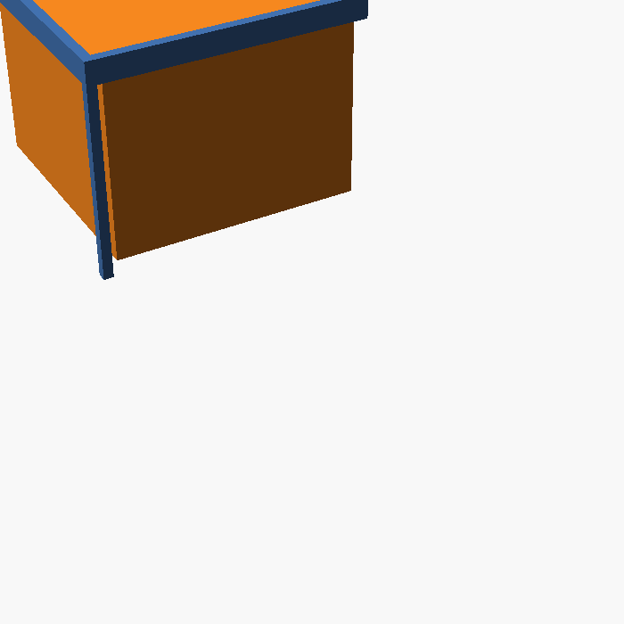

# Case schermato per raggi X da 2X2A in sovratensione

Progetto parametrico (OpenSCAD) di un contenitore stampabile in 3D che racchiude
un tubo raddrizzatore **2X2A** usato come sorgente di raggi X. Schermatura con
**lastre di piombo da 2 mm** su tutte e sei le facce e **una finestra** con
membrana stampata, filtro in alluminio e otturatore piombato.



| Assieme | Corpo | Finestra | Passacavi a labirinto |
|---|---|---|---|
|  |  |  |  |

---

## 1. Cosa dice la ricerca online

**Il tubo.** Il 2X2A è un raddrizzatore EHT a semionda, a vuoto spinto, per
alimentatori di CRT e radar: 12,5 kV di tensione inversa di picco (PIV) a 7,5 mA, filamento 2,5 V / 1,75 A,
zoccolo UX4 (4 piedini) con cappuccio superiore (= anodo/placca). Ampolla di circa 36 mm di
diametro e circa 97 mm di altezza esclusi i piedini. Equivalenti: 2X2, 2B21, 879, CV597.

**Chi lo usa per i raggi X.** È un esperimento hobbistico classico:

- Un costruttore lo alimenta con un **trasformatore flyback + moltiplicatore**, a circa **50 kV**
  (stima); un tentativo precedente con un generatore di Marx non aveva prodotto raggi X perché il tubo
  inizia a condurre solo verso **40 kV**.
- Altri lo alimentano con macchine elettrostatiche (Wimshurst, Van de Graaff).
- Si legge che United Nuclear, che vendeva tubi "experimenter", **selezionava molti 2X2A** per
  tenere quelli che emettevano abbastanza: la resa cambia molto da un esemplare all'altro.
- Un costruttore riporta circa **800 µSv/h a 15 cm** dal tubo. È una dose seria: a
  quella distanza bastano circa 75 minuti di esposizione per arrivare al limite annuo di 1 mSv della popolazione.

**Da dove escono i raggi X.** Il tubo non è fatto per produrre raggi X, quindi non dà un fascio
come un tubo Coolidge. Gli elettroni del catodo, accelerati dalla tensione, colpiscono la **placca
(anodo)**. I raggi X di frenamento (bremsstrahlung) partono dalla placca, ma secondo chi l'ha misurato
**la maggior parte dell'emissione esce attorno al bordo inferiore della "campana" anodica**, cioè il bordo aperto
del cilindro della placca, rivolto verso lo zoccolo. Il risultato è un **anello diffuso** di
radiazione, perpendicolare all'asse del tubo. Un costruttore ha ottenuto le immagini più nitide
**inclinando il tubo di circa 45°**. Il vetro stesso, colpito da elettroni vaganti, contribuisce poco.

Conseguenze per il progetto:
1. il tubo emette **in tutte le direzioni** → schermatura completa su 6 facce, non solo davanti;
2. la finestra va messa **all'altezza del bordo inferiore della placca** (parametro `anode_rim_h`);
3. serve un **filtro in alluminio** per togliere i raggi X molli, che danno dose alla pelle senza
   migliorare l'immagine (lo consigliano anche i costruttori).

## 2. Il piombo da 2 mm basta?

Coefficienti di attenuazione del piombo (NIST XCOM, ρ = 11,35 g/cm³), trasmissione attraverso 2 mm:

| Energia fotoni | µ/ρ (cm²/g) | Trasmissione 2 mm Pb |
|---|---|---|
| 30 keV | 30,3 | ~10⁻³⁰ |
| 50 keV | 8,04 | ~1·10⁻⁸ |
| 60 keV | 5,02 | ~1·10⁻⁵ |
| 80 keV | 2,42 | ~4·10⁻³ |

L'energia massima dei fotoni, in keV, è pari alla tensione di picco in kV. Con 40–60 kV,
2 mm di piombo sono un ampio margine. **Sopra ~70 kV il margine cala**: in quel caso aumenta
`lead_t` e misura con un dosimetro.

## 3. Struttura del case

- **Corpo**: un unico pezzo con doppia parete (2,4 mm PETG + **intercapedine 2,4 mm** + 2,4 mm PETG).
  L'intercapedine è un anello continuo aperto in alto: le 4 lastre si infilano dall'alto.
  Le 2 lastre "lunghe" coprono gli spigoli, le 2 "corte" ci battono contro: **nessuna fessura negli spigoli**.
- **Fondo**: lastra di Pb appoggiata dentro la cavità. L'intercapedine scende fino a 1,2 mm dal
  fondo, cioè **sotto** il piombo del fondo: non c'è una linea retta che passi tra le due lastre.
- **Coperchio**: lastra di Pb grande quanto tutto il corpo, appoggiata sui bordi e sulle lastre delle
  pareti, trattenuta da una gonna stampata (biadesivo per tenerla nel coperchio). Ha una tacca per un
  **microswitch di interblocco** (AT spenta a coperchio aperto).
- **Distanze di isolamento**: cavità di 118 × 118 × 197 mm, perché il piombo va **messo a terra** e
  il cappuccio anodico è a +40–50 kV. Ci sono ≥ 40 mm d'aria tra parti in AT e piombo (`hv_clear`, ~1 mm/kV).
- **Passacavi a labirinto** (`hood`): una copertura a L con tetto e due fianchi piombati, rivolti
  verso il tubo, e i lati aperti verso le pareti. Ogni raggio rettilineo dal tubo al foro del cavo
  attraversa il piombo. Uno va sul fondo (cavi BT: filamento, catodo, terra) e uno, capovolto, sotto
  il coperchio (cavo AT).
- **Finestra**:
  - foro Ø20 nella lastra di piombo frontale: è il collimatore;
  - **membrana stampata da 0,8 mm** nella parete interna: tiene fuori dita e polvere e
    attenua solo ~3% a 30 keV;
  - **modulo finestra** avvitato su 4 borchie (M3 autofilettanti), con:
    - una fessura per un **filtro Al** (0,5–1 mm, 44 × 60);
    - un **otturatore** con piastrina di Pb 30 × 30 × 2. Chiuso è la posizione di riposo, tenuta
      dalla gravità; lo si solleva di 40 mm e lo si blocca con un perno Ø3 per aprire.

Dimensioni d'ingombro: 132 × 132 × 205 mm (corpo stampato con i piedini). Piombo totale: circa **3 kg**.

## 4. File

```
xray_case_2x2a.scad      sorgente parametrico (tutto qui)
stl/                     body, lid, tray, hood (x2), window_frame, shutter
lead_templates/          sagome .svg/.dxf in scala 1:1 per tagliare il piombo
render/                  immagini; tools/section_svg.py genera la sezione
```

Rigenerare (ad es. dopo aver cambiato le misure del tubo):

```sh
for p in body lid tray hood window_frame shutter; do
  openscad -D "part=\"$p\"" -o stl/$p.stl xray_case_2x2a.scad; done
for p in lead_long lead_long_window lead_short lead_floor lead_lid lead_shutter lead_hood_roof lead_hood_side; do
  openscad -D "part=\"$p\"" -o lead_templates/$p.svg xray_case_2x2a.scad; done
```

**Prima di stampare misura il tuo tubo** e correggi `tube_seated_h` e soprattutto
`anode_rim_h`, la distanza dal piano dello zoccolo al bordo inferiore della placca, visibile attraverso
il vetro. Controlla anche `socket_mount`, l'interasse dei fori del tuo zoccolo.

### Lastre di piombo (valori di default)

| Pezzo | Q.tà | Misure (mm) | Note |
|---|---|---|---|
| `lead_long` | 1 | 127,2 × 198,8 | parete posteriore |
| `lead_long_window` | 1 | 127,2 × 198,8 | parete frontale, foro Ø20 |
| `lead_short` | 2 | 122,4 × 198,8 | pareti laterali |
| `lead_floor` | 1 | 117,5 × 117,5 | foro Ø8 per i cavi BT |
| `lead_lid` | 1 | 132,4 × 132,4 | foro Ø8 per il cavo AT |
| `lead_shutter` | 1 | 30 × 30 | otturatore |
| `lead_hood_roof` / `_side` | 2 + 4 | 27 × 27 / 27 × 19,6 | passacavi |

## 5. Stampa e montaggio

1. Stampa in **PETG o ASA** (non PLA: il tubo scalda e il PLA si deforma a ~55 °C), con 3–4 perimetri e
   layer da 0,2 mm. Stampa il corpo in piedi, senza supporti (il foro della finestra è a goccia).
   Coperchio, supporto e passacavi vanno stampati capovolti; l'otturatore va stampato in piano.
2. Taglia il piombo con le sagome. Usa guanti e lavati le mani; il piombo non va carteggiato. Si
   può verniciare o rivestire di nastro kapton.
3. Incolla il passacavi BT sul piombo del fondo, sopra il foro, con i lati aperti verso l'angolo.
   Inserisci le 4 lastre nell'intercapedine: prima le lunghe, poi le corte.
4. **Messa a terra**: unisci tutte le lastre con nastro di rame e collegale alla terra
   dell'alimentatore, cioè al ritorno del catodo, con un filo che esce dal passacavi BT.
5. Il cavo AT deve essere **siliconico per AT, ≥ 40 kV DC**. Passa dal passacavi del coperchio e arriva al
   cappuccio anodico lontano dalle pareti.
6. Monta il modulo finestra, inserisci il filtro Al e lascia l'otturatore abbassato (chiuso).

## 6. Sicurezza: leggere prima di accendere

- **Verifica la schermatura con un dosimetro/contatore** (per i raggi X a bassa energia serve
  un tubo Geiger a finestra sottile o una camera a ionizzazione), su tutte le facce, negli spigoli, ai
  passacavi e al coperchio, partendo da tensioni basse. La stampa 3D e le misure del tubo non
  sostituiscono la misura.
- **Mai guardare dentro né mettere mani o occhi davanti alla finestra aperta.** Comanda l'apparato
  da lontano (distanza + tempo + schermo).
- **L'AT a 40–50 kV è letale**, e i moltiplicatori restano carichi: scaricali con un'asta di
  scarica prima di aprire. Usa l'interblocco sul coperchio.
- Si genera **ozono**: lavora in un ambiente ventilato. I cicli di lavoro devono essere brevi,
  perché il case è chiuso e non ventilato (apposta: le prese d'aria sarebbero fughe di radiazione).
- In Italia gli apparecchi che generano radiazioni ionizzanti ricadono nel **D.Lgs. 101/2020**:
  informati sugli obblighi (notifica, esperto di radioprotezione) prima di usarlo, soprattutto a scuola o
  in università.

## Fonti

- [Radiomuseum – 2X2A](https://radiomuseum.org/tubes/tube_2x2a.html) (12,5 kV PIV, 7,5 mA, filamento 2,5 V 1,75 A, UX4 + cappuccio)
- [R-Type – 2X2A](https://r-type.org/exhib/aaa0506.htm) (dimensioni, equivalenti)
- [Quantumnet – 2X2A X-ray tube](http://quantumnet.wikidot.com/2x2a)
- [Uzzors2k – Tube X-ray](http://uzzors2k.com/index.php?page=tubexray)
- [Civilpedia – X-Rays with the 2x2A](https://civilpedia.org/p/?pid=304)
- [Science Buddies – discussione 2X2A come sorgente X](https://www.sciencebuddies.org/science-fair-projects/ask-an-expert/viewtopic.php?p=47197)
- [Electrostatic Machines (UFRJ)](https://www.coe.ufrj.br/~acmq/electrostatic.html)
- NIST XCOM / X-Ray Mass Attenuation Coefficients (piombo)
