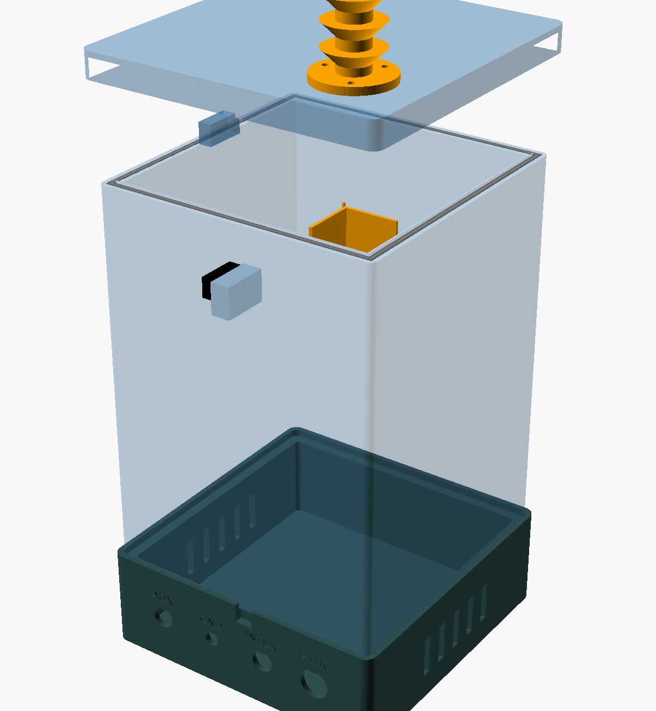
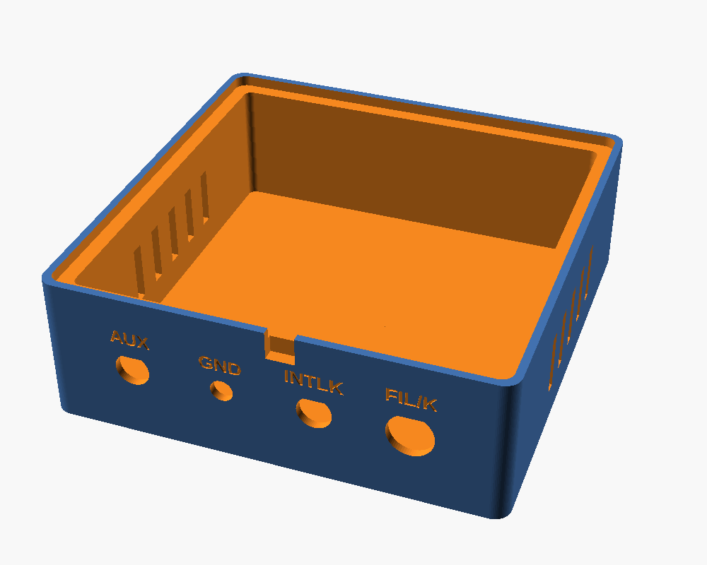
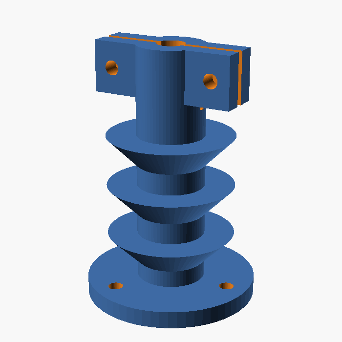

# Case schermato per raggi X da 2X2A in sovratensione

Progetto parametrico (OpenSCAD) di un contenitore stampabile in 3D per un tubo
raddrizzatore **2X2A** usato come sorgente di raggi X, dimensionato per una
**Creality K2 Pro** (piano 300 × 300 × 300 mm).

- schermatura in **fogli di piombo da 1 mm sovrapposti**: default **3 fogli = 3 mm**
  (`lead_n = 2` per 2 mm), su tutte e sei le facce, con giunti sfalsati tra gli strati;
- **finestra** per i raggi X con membrana stampata, filtro Al e otturatore piombato;
- **basamento con pannello connettori** (filamento/catodo, interblocco, terra, riserva);
- **passante AT** con alette sul coperchio, **microswitch di interblocco**, passacavi a labirinto.


| Fronte | Retro | Basamento | Passante AT |
|---|---|---|---|
|  |  |  |  |

| Corpo | Modulo finestra | Passacavi a labirinto |
|---|---|---|
|  |  |  |

---

## 1. Cosa dice la ricerca online

**Il tubo.** Il 2X2A è un raddrizzatore EHT a semionda, a vuoto spinto, per alimentatori di CRT e radar:
12,5 kV PIV a 7,5 mA, filamento 2,5 V / 1,75 A, zoccolo UX4 (4 piedini) e cappuccio superiore (anodo/placca).
L'ampolla misura circa 36 mm di diametro e 97 mm di altezza esclusi i piedini.
Equivalenti: 2X2, 2B21, 879, CV597.

**Chi lo usa per i raggi X.** È un esperimento hobbistico classico:

- Un costruttore lo alimenta con un **trasformatore flyback + moltiplicatore** a circa **50 kV** (stima).
  Con un generatore di Marx non otteneva raggi X: il tubo inizia a condurre solo verso **40 kV**.
- Altri usano macchine elettrostatiche (Wimshurst, Van de Graaff).
- United Nuclear **selezionava molti 2X2A** per tenere quelli che emettevano di più: la resa
  cambia molto da un esemplare all'altro.
- Un costruttore riporta circa **800 µSv/h a 15 cm** dal tubo. Con circa 75 minuti a quella distanza si raggiunge
  il limite annuo per la popolazione (1 mSv).

**Da dove escono i raggi X.** Il tubo non è fatto per produrre raggi X e non dà un fascio come un tubo Coolidge.
Gli elettroni del catodo colpiscono la **placca (anodo)** e producono raggi X di frenamento.
Secondo chi l'ha misurato, la maggior parte dell'emissione esce **attorno al bordo inferiore della "campana"
anodica**, cioè il bordo aperto del cilindro della placca rivolto verso lo zoccolo.
L'emissione forma un **anello diffuso** perpendicolare all'asse del tubo.
Un costruttore ha ottenuto le immagini migliori **inclinando il tubo di circa 45°**.

Conseguenze per il progetto:

1. il tubo emette in tutte le direzioni, quindi serve una schermatura completa su 6 facce;
2. la finestra va all'altezza del bordo inferiore della placca (parametro `anode_rim_h`);
3. serve un filtro in alluminio per togliere i raggi X molli, che danno dose alla pelle e non servono all'immagine.

## 2. Spessore del piombo: 2 o 3 mm?

Coefficienti di attenuazione del piombo (NIST XCOM, ρ = 11,35 g/cm³):

| Energia fotoni | µ/ρ (cm²/g) | Trasmissione 2 mm | Trasmissione **3 mm** |
|---|---|---|---|
| 50 keV | 8,04 | 1·10⁻⁸ | 1·10⁻¹² |
| 60 keV | 5,02 | 1·10⁻⁵ | 4·10⁻⁸ |
| 80 keV | 2,42 | 4·10⁻³ | 3·10⁻⁴ |
| 88 keV (sotto il bordo K) | ~1,9 | 1·10⁻² | 1,5·10⁻³ |

L'energia massima dei fotoni in keV è pari alla tensione di picco in kV. Con 40–60 kV bastano già 2 mm.
**3 mm conviene se l'alimentatore può salire verso 80–90 kV**: lo spessore in più divide per circa 10 ciò che
passa ai picchi. In più, con fogli sovrapposti e giunti sfalsati, nessuna fessura attraversa tutto lo spessore.
Il default è quindi **3 fogli da 1 mm**.

## 3. Struttura

Dimensioni con i valori di default:

| Pezzo | Ingombro (mm) | Stampa su K2 Pro |
|---|---|---|
| Corpo | 154,8 × 154,8 × 211 | in piedi, nessun supporto |
| Basamento | 161,4 × 161,4 × 54 | così com'è, nessun supporto |
| Coperchio | 161,4 × 161,4 × 17 | capovolto |
| Passante AT, finestra, otturatore, supporto, passacavi ×2 | piccoli | vedi sotto |

- **Corpo**: un unico pezzo a doppia parete (PETG 2,4 + **intercapedine 3,6 mm** + PETG 2,4).
  L'intercapedine è un anello continuo aperto in alto e i fogli si infilano dall'alto, uno strato alla volta.
  Negli strati 1 e 3 le lastre lunghe stanno davanti e dietro, nello strato 2 ai lati: **i giunti d'angolo sono sfalsati**.
  L'intercapedine scende 1,8 mm **sotto** il piombo del fondo, quindi non c'è una linea retta che passi tra pareti e fondo.
- **Cavità** di 138 × 138 × 208 mm: ci sono **≥ 50 mm d'aria** tra le parti in AT e il piombo, che va a terra (`hv_clear`).
- **Coperchio**: 3 fogli quadrati appoggiati sul bordo e sulle lastre delle pareti, dentro una gonna stampata.
  Ha un **dito che preme il microswitch** di interblocco quando è chiuso.
- **Passante AT** (`hv_bushing`): tubo isolante con alette a 45° (allungano il percorso superficiale) e serracavo
  a vite in cima. Si avvita con 3 viti M3 sul coperchio, nell'angolo posteriore sinistro.
- **Passacavi a labirinto** (`hood`), due uguali, con tasche per 3 fogli su tetto e fianchi:
  - uno sul fondo, angolo posteriore destro, per i cavi BT verso il basamento;
  - uno capovolto sotto il coperchio, per il cavo AT.

  Ogni raggio rettilineo dal tubo al foro del cavo attraversa il piombo.
- **Finestra** frontale, all'altezza della placca:
  - foro Ø20 in ciascuno dei 3 fogli frontali (collimatore);
  - membrana stampata da 0,8 mm (attenua ~3% a 30 keV);
  - modulo avvitato con fessura per il **filtro Al** e **otturatore** con 3 fogli 30 × 30.
    Chiuso è la posizione di riposo (per gravità); per aprirlo lo si solleva di 40 mm e lo si blocca con un perno Ø3.
- **Basamento con connettori**: è una vaschetta su cui il corpo si appoggia e che il corpo stesso chiude.
  I cavi BT scendono dal fondo del corpo; i fili dell'interblocco entrano dalla tacca posteriore.
  Ha feritoie laterali di ventilazione, fuori dallo schermo e solo nella zona BT. Il pannello posteriore porta:

| Etichetta | Connettore | Uso |
|---|---|---|
| FIL/K | GX16-4 | filamento 2,5 V (2 poli) + catodo |
| INTLK | GX12-2 | contatto NA del microswitch, da mettere in serie all'abilitazione del driver AT |
| GND | morsetto 4 mm / prigioniero M5 | terra: piombo + ritorno catodo |
| AUX | GX12-3 | riserva (sensore temperatura, contatore, LED "AT ON") |

  I fori sono a "D" con il piatto antirotazione; la parete è assottigliata a 3 mm dietro ogni connettore per la ghiera.
  Diametri e posizioni sono nell'array `connectors` del file `.scad`.

## 4. File

```
xray_case_2x2a.scad      sorgente parametrico
build.sh                 rigenera stl/, lead_templates/ e render/
stl/                     body, lid, plinth, hv_bushing, tray, hood (x2), window_frame, shutter
lead_templates/          sagome 1:1 .svg/.dxf per tagliare il piombo
tools/section_svg.py     disegno della sezione
```

**Prima di stampare** misura il tuo tubo e correggi:

- `anode_rim_h`: distanza dal piano dello zoccolo al bordo inferiore della placca. Decide l'altezza della finestra.
- `tube_seated_h`: altezza del tubo montato.
- `socket_mount`: interasse dei fori del tuo zoccolo.
- `connectors`: diametri dei fori, se i tuoi connettori sono diversi.

Poi lancia `./build.sh`. Lo spessore si cambia con `lead_n`: tutto si adatta, cioè intercapedine,
tasche, otturatore, sagome e verifica d'ingombro sul piano della K2 Pro.

### Fogli di piombo da 1 mm (default, 3 strati)

| Sagoma | Q.tà | Misure (mm) | Note |
|---|---|---|---|
| `wall_L1_front` / `_back` | 1 + 1 | 145,1 × 209,8 | strato interno; front con foro Ø20 |
| `wall_L1_side` | 2 | 143,1 × 209,8 | |
| `wall_L2_front` / `_back` | 1 + 1 | 145,1 × 209,8 | front con foro Ø20 |
| `wall_L2_side` | 2 | 147,1 × 209,8 | |
| `wall_L3_front` / `_back` | 1 + 1 | 149,1 × 209,8 | strato esterno; front con foro Ø20 |
| `wall_L3_side` | 2 | 147,1 × 209,8 | |
| `floor` | 3 | 137,5 × 137,5 | foro Ø8 cavi BT |
| `lid` | 3 | 154,8 × 154,8 | foro Ø8 cavo AT |
| `shutter` | 3 | 30 × 30 | otturatore |
| `hood_roof` / `hood_side` | 6 / 12 | 31 × 31 / 31 × 22,6 | 2 passacavi × 3 strati |

In tutto servono circa **0,5 m² di foglio da 1 mm, cioè circa 5,8 kg di piombo**.

## 5. Distinta componenti (oltre al piombo)

- PETG o ASA: circa 1,2 kg. Non usare PLA: il tubo scalda e il PLA si deforma a ~55 °C.
- Zoccolo UX4 ceramico + 2 viti M3.
- Connettori: GX16-4 da pannello + spina, GX12-2 e GX12-3 da pannello + spine, morsetto 4 mm o prigioniero M5.
- Microswitch tipo KW11-3Z (20 × 6,4 × 10,2) + 2 viti M2 autofilettanti.
- Viti: 4 × M3 autofilettanti (modulo finestra), 3 × M3 autofilettanti (passante AT), 2 × M3 + dado (serracavo).
- Cavo AT siliconico **≥ 40 kV DC** (Ø 4–7 mm) con clip per il cappuccio anodico.
- Lamierino di alluminio da 0,5–1 mm (filtro 44 × 60), nastro di rame adesivo, biadesivo o colla per il piombo.

## 6. Stampa e montaggio

1. **Stampa**: 3–4 perimetri, layer 0,2 mm. Corpo e basamento vanno in piedi così come sono; coperchio,
   supporto e passacavi capovolti (`build.sh` li esporta già orientati); otturatore in piano;
   modulo finestra e passante AT in piedi.
2. **Piombo**: taglialo con le sagome; un cutter e un righello bastano per 1 mm. Lavora con guanti, lavati le
   mani e non carteggiare. Spiana bene i fogli, altrimenti non entrano nell'intercapedine.
3. **Fondo**: posa i 3 fogli del fondo con i fori allineati, poi incolla sopra il passacavi BT con i lati
   aperti verso l'angolo.
4. **Pareti**: inserisci gli strati nell'ordine L1 (interno), L2, L3, rispettando quali lastre sono lunghe.
   Allinea i fori della finestra dei 3 fogli frontali.
5. **Terra**: collega i fogli fra loro con nastro di rame su un bordo superiore, prima di chiudere, e porta un
   filo dal passacavi BT al morsetto **GND** del basamento. Collega lì anche il ritorno del catodo e la terra
   dell'alimentatore AT.
6. **Zoccolo e tubo**: monta lo zoccolo sul supporto e passa i fili del filamento e del catodo dal foro del fondo
   fino al GX16. **Verifica il pinout del 2X2A** sul datasheet (heater/cathode sui piedini; anodo sul cappuccio).
7. **AT**: monta il passante sul coperchio e il passacavi capovolto sotto i fogli del coperchio. Fai arrivare
   il cavo al cappuccio anodico lontano dalle pareti.
8. **Interblocco**: avvita il microswitch sul blocchetto posteriore e regola con una rondella che il dito del
   coperchio lo azioni a coperchio chiuso. Porta i fili, lungo la parete e attraverso la tacca, al GX12 **INTLK**.
   Il driver AT deve accendersi solo con il contatto chiuso.
9. **Finestra**: avvita il modulo, inserisci il filtro Al e lascia l'otturatore abbassato (chiuso).

## 7. Sicurezza: leggere prima di accendere

- **Verifica la schermatura con un rilevatore adatto ai raggi X molli**, cioè un Geiger a finestra sottile o
  una camera a ionizzazione. Controlla tutte le facce, gli spigoli, i passacavi, il passante AT e il bordo del
  coperchio, partendo da tensioni basse. La stampa 3D e le misure stimate del tubo non sostituiscono la misura.
- **Mai mani o occhi davanti alla finestra aperta.** Comanda l'apparato da lontano: distanza, tempo e schermo.
- **L'AT a 40–80 kV è letale** e i moltiplicatori restano carichi: scaricali con un'asta di scarica prima di aprire.
  L'interblocco non sostituisce la scarica.
- Si genera **ozono**: lavora in un ambiente ventilato. Fai cicli brevi: la cavità schermata è chiusa e senza
  prese d'aria, perché le prese d'aria sarebbero fughe di radiazione.
- In Italia gli apparecchi che generano radiazioni ionizzanti ricadono nel **D.Lgs. 101/2020**: informati sugli
  obblighi (notifica, esperto di radioprotezione) prima dell'uso, soprattutto a scuola o in università.

## Fonti

- [Radiomuseum – 2X2A](https://radiomuseum.org/tubes/tube_2x2a.html)
- [R-Type – 2X2A](https://r-type.org/exhib/aaa0506.htm)
- [Quantumnet – 2X2A X-ray tube](http://quantumnet.wikidot.com/2x2a)
- [Uzzors2k – Tube X-ray](http://uzzors2k.com/index.php?page=tubexray)
- [Civilpedia – X-Rays with the 2x2A](https://civilpedia.org/p/?pid=304)
- [Science Buddies – discussione 2X2A come sorgente X](https://www.sciencebuddies.org/science-fair-projects/ask-an-expert/viewtopic.php?p=47197)
- [Electrostatic Machines (UFRJ)](https://www.coe.ufrj.br/~acmq/electrostatic.html)
- NIST XCOM / X-Ray Mass Attenuation Coefficients (piombo)
